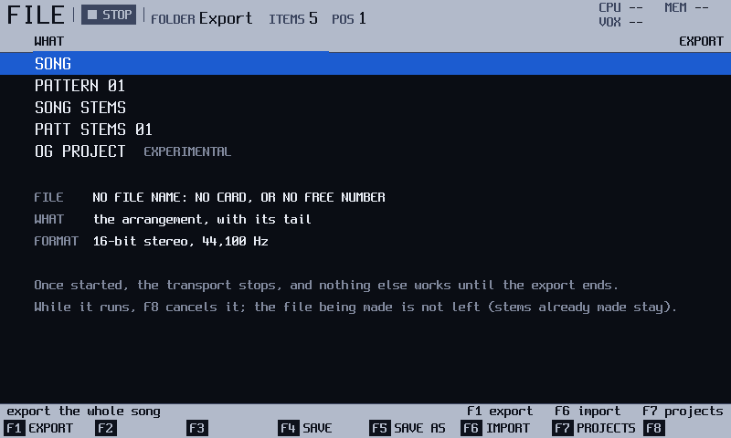
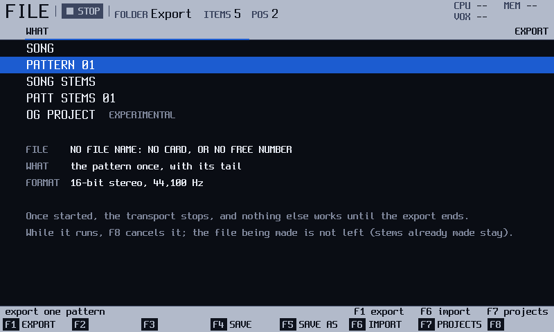
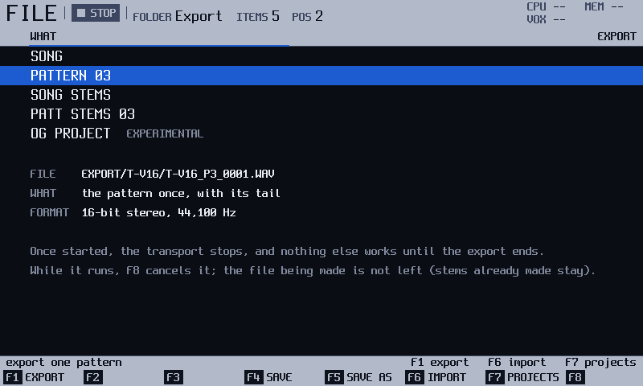

# Export
<!-- manual-sync: f5e29c02 -->

Status: draft

Export writes what the unit plays to WAV files on the card, and the tools are spread over three screens: the EXPORT page of File, the TOOLS list of Pattern and the TOOLS dialog of Song. Song, pattern and stems exports work as the official manual describes. The stems are one WAV for each audio track that plays a note, plus the DELAY, REVERB and MIX files. The files are named differently: `Export/<PROJECT>/<PROJECT>_Song0001.wav`, and a second render takes the next number instead of a new folder. <!-- og: same, names different --> **OG PROJECT** writes a folder in the original firmware's project format and is marked EXPERIMENTAL. Not checked against the original firmware: whether an official unit opens it. <!-- og: open -->

<!-- Sources: docs/qa/catalogue/file.md, QA-FIL-020..025 (EXPORT page and WAV files), QA-FIL-050..057 (stems), QA-FIL-081..094 (OG PROJECT); docs/qa/catalogue/pattern.md, QA-PAT-114 (channel pan), QA-PAT-160..189 (TOOLS, EXPORT PATTERN, EXPORT SELECTION); docs/qa/catalogue/song.md, QA-SNG-059 (EXPORT WAV of slots). -->
<!-- Open rows, not written: none in these ranges. QA-FIL-089 (an official unit opens the OG PROJECT folder) is an open research question, written as such. -->
<!-- Map rows: song, pattern and stems export are same (QA-FIL-021, QA-FIL-051, QA-FIL-055); folders and names are different (QA-FIL-021, OS-WAVEXP). -->
<!-- Resolved: the name on the card is Untitled (app/src/save_service.cpp); the strip shows it in capitals (QA-FIL-021). -->

## What it is for

Export writes what the unit plays to files on the card, in the folder `Export/<PROJECT>`. You can export the whole song, some slots of the song, one pattern, a block of a pattern, or the separate tracks (stems). These exports are WAV files.

**OG PROJECT** writes a folder in the project format of the original firmware. It is **EXPERIMENTAL**. See the last section.

Exports never change the project. Starting an export stops the transport. <!-- QA-FIL-025, QA-FIL-057 -->

## How it works
<!-- sync: src=app/src/app_export.cpp qa=QA-FIL-021,QA-FIL-022,QA-FIL-025,QA-FIL-057 -->

An export is an offline render: the unit renders the song, a pattern or a block without playing it aloud and writes the result as 16-bit stereo, 44,100 Hz WAV files in `Export/<PROJECT>` on the card. Nothing is live. Your project is not changed. <!-- QA-FIL-025, QA-FIL-057 -->

While it runs, only `F8` (**CANCEL**) works. The pads, `Play`, `Rec` and the screen buttons do nothing; nothing is queued for later. Cancelling, or the end of the render, gives the keys back. A second export never writes over the first: it makes `_0002`. <!-- QA-FIL-021, QA-FIL-022 -->

Example: to bring one drum pattern into another program, choose **PATTERN nn** and press `F1`. To mix it there, choose **PATT STEMS nn** instead, and you get one file for each audio track that plays a note, plus the DELAY, REVERB and MIX files.

## Try it
<!-- sync: src=app/src/app_export.cpp qa=QA-FIL-020,QA-FIL-021 -->

This walk-through exports one pattern.

1. Press `File`. The File screen opens on the PROJECTS page.
2. Press `F7` (**EXPORT**). The EXPORT page opens with the cursor on the row you used last. Press `Up` until it stops on **SONG**, the first row. <!-- QA-FIL-020 -->

   
3. Press `Down`. The cursor is on **PATTERN nn**. The screen says what you get: the pattern once, with its tail. Turn the encoder to choose another pattern if the project has one. <!-- QA-FIL-020 -->

   
4. Press `F1` (**EXPORT**). A progress overlay shows while it renders.
5. When it ends, the strip says `SAVED EXPORT/<PROJECT>/<PROJECT>_P<n>_0001.WAV`. The file is on the card. <!-- QA-FIL-021 -->

## The screen at a glance

| Row | What `F1` makes |
|---|---|
| SONG | The whole song, as one WAV file. |
| PATTERN nn | The pattern nn, as one WAV file. |
| SONG STEMS | One WAV file for each audio track that plays a note, and the DELAY, REVERB and MIX files. |
| PATT STEMS nn | The same set, for the pattern nn. |
| OG PROJECT | A project folder in the original firmware's format. EXPERIMENTAL. |

The page is on the File screen, on the PROJECTS page, with `F7` (**EXPORT**). The card under the rows shows the file name `F1` will make. From the Pattern screen, the same WAV exports are in the TOOLS list. <!-- QA-FIL-020, QA-PAT-180 -->

## More tasks

### Export a pattern from the EXPORT page

Start on the File screen, on the PROJECTS page.

1. Press `F7` (**EXPORT**), then `Up` until the cursor stops on **SONG**. The page keeps the row you used last. <!-- QA-FIL-020 -->
2. Press `Down` to **PATTERN nn**. The nn starts at the pattern you were on. <!-- QA-FIL-020 -->
3. Turn the encoder to the pattern you want. It moves to the next pattern that exists. <!-- QA-FIL-020 -->
4. Press `F1` (**EXPORT**). <!-- QA-FIL-021 -->

You should see `SAVED EXPORT/<PROJECT>/<PROJECT>_P<n>_0001.WAV` when it ends. Exporting again makes `_0002`, and never writes over the first file. <!-- QA-FIL-021 -->

### Export the pattern on screen from the Pattern screen

Start on the Pattern screen, with the transport stopped.

1. Press `F7` (**TOOLS**). The list opens, with **EXPORT PATTERN** first. <!-- QA-PAT-180 -->
2. Press `F1` (**EXPORT**) on **EXPORT PATTERN**. <!-- QA-PAT-180 -->

The file is `<PROJECT>_P<n>_0001.WAV`, as on the EXPORT page. <!-- QA-PAT-180 --> While the view follows the play line (WATCH while playing, or LIVE), the list does not open and the strip says **STOP PLAYING TO OPEN TOOLS**. Press `Play` to stop, then `F7`. <!-- QA-PAT-161 -->

### Export a block of the pattern
<!-- sync: src=app/src/export_actions.cpp qa=QA-PAT-185,QA-PAT-186,QA-PAT-319 -->

Start on the Pattern screen, in **STEP**.

1. Select the block with `Shift` and the arrows. <!-- QA-PAT-185 -->
2. Press `F7` (**TOOLS**). The list shows **EXPORT SELECTION** below **EXPORT PATTERN** and the three pattern tools. <!-- QA-PAT-185 -->
3. Press `Down` four times to **EXPORT SELECTION**, then `F1` (**EXPORT**). <!-- QA-PAT-186 -->

You should see `SAVED EXPORT/<PROJECT>/<PROJECT>_SEL0001.WAV`. The file holds only the tracks of the block, from its first row to the end of its last row. The other tracks are muted in the file. A block that covers only some columns of a track still exports that track's whole steps. <!-- QA-PAT-186, QA-PAT-319, OS-AUDIT-56 in app/src/export_actions.cpp -->

> **Tip**: The selection ends at the first silence after the block. **EXPORT PATTERN** keeps the tail of its reverb and delay. <!-- QA-PAT-189 -->

### Export some slots of the song

Start on the Song screen. The transport may be playing: the export stops it.

1. Pick the slots. With the cursor on **PAT**, `Shift` + `Down` or `Up` extends a range of slots. With no range, the export takes the slot under the cursor. <!-- QA-SNG-059 -->
2. In the track map, `Shift` + `Left` or `Right` also picks tracks. With no range of tracks or slots selected, the export takes every track. A range of slots with no range of tracks, picked in the map, renders only the track under the cursor. <!-- QA-SNG-059 -->
3. Press `F6` (**TOOLS**). On the **OP** row, turn the encoder, or press `Left` or `Right`, to **EXPORT WAV**. The row below it goes, and the footer names the slots and the tracks. <!-- QA-SNG-059 -->
4. Press `F1` (**APPLY**). <!-- QA-SNG-059 -->

The progress overlay reads **EXPORTING THE SLOTS**. You should see `SAVED EXPORT/<PROJECT>/<PROJECT>_S<a>-<b>_0001.WAV`. The numbers are the Song screen's slot numbers, so the first slot is `S0`. A second export of the same slots is `_0002`, and nothing is written over. <!-- QA-SNG-059 -->

The file runs from the first slot to the end of the last, then keeps the tail of the delay and the reverb, as the song export does. It holds the tracks you picked, or every track. A muted or soloed track you picked does sound. If the slots hold an Order jump that goes back inside them, the export loops as the song does, until it stops with `TOO LONG FOR A WAV (100 MIN)`; `F8` (**CANCEL**) stops it sooner. <!-- QA-SNG-059 -->

> **Tip**: The SONG row of the EXPORT page is not changed. It still writes the whole song as `<PROJECT>_Song0001.WAV`. <!-- QA-SNG-059, QA-FIL-021 -->

**Not yet checked on the unit.** The host tests pass. <!-- QA-SNG-059 -->

### Export the stems

Start on the File screen, on the EXPORT page.

1. Press `Up` until the cursor stops on **SONG**, then `Down` three times to **PATT STEMS nn**. For the song, press `Up` once, to **SONG STEMS**. <!-- QA-FIL-050 -->
2. For a pattern, turn the encoder to the pattern you want. <!-- QA-FIL-050 -->
3. Press `F1` (**EXPORT**). <!-- QA-FIL-051 -->

You should see `SAVED n STEMS` when it ends. The files are `<PROJECT>_P<n>_S0001_T01.wav` and so on, then `_DELAY`, `_REVERB` and `_MIX`. For the song, the name uses `Song` in place of `P<n>`. <!-- QA-FIL-051 -->

Which files a set has: one track file for each audio track that plays a note. A track with no notes, a MIDI track and a MIDI instrument have no file. DELAY and REVERB appear only when that bus can sound. MIX is always there, and it is the last file. <!-- QA-FIL-055 -->

All the files of a set have the same length. A second set gets the next number, `S0002`, and it never writes over the first set. <!-- QA-FIL-051 -->

### Cancel an export

1. Press `F8` (**CANCEL**) while the progress overlay is up. <!-- QA-FIL-023, QA-FIL-053 -->

The strip says **EXPORT CANCELLED**, or `CANCELLED: n OF m STEMS SAVED` for a set. The files already finished stay on the card. The file being written is not left on the card. <!-- QA-FIL-023, QA-FIL-053 -->

### Export the project for the original firmware (EXPERIMENTAL)

Start on the File screen, on the EXPORT page.

1. Press `Down` until the cursor stops on **OG PROJECT**, the last row. The row reads **EXPERIMENTAL**. <!-- QA-FIL-082 -->
2. Read the card. It shows the folder name, the size, and the list **LOSES**. The list says what the export would leave out. While it says **COUNTING...**, there is no size or list yet. <!-- QA-FIL-082 -->
3. Press `F1` (**EXPORT**). If something would be left out, the strip says `LOSES <n kinds>: F1 AGAIN`. Press `F1` again to go on. If the count is not done, the strip says `COUNTING WHAT THE EXPORT LOSES: WAIT`, and `F1` starts nothing. <!-- QA-FIL-083 -->
4. Wait for the end. The strip says **SAVED**, and it names any kinds that were not kept. <!-- QA-FIL-083, QA-FIL-084 -->

You should see the folder `Export/<NAME> OG` on the card. A second export makes `<NAME> OG 2`, and so on up to `OG 99`. Nothing already on the card changes. <!-- QA-FIL-084 -->

> **Careful**: `F8` stops the export. The finished files stay, but there is no project file until the last file is done. The folder is then not a project. <!-- QA-FIL-082, QA-FIL-087 -->

The export asks first only when something would be left out. Any other key, a move, leaving the screen or waiting 4 seconds takes the question back. If the project changes while the question is up, `F1` counts again and asks with the new count. <!-- QA-FIL-083 -->

The export refuses while a take is armed or recording, while a job, a load or a save runs, and on a card it cannot write (no card, a write-protected card or an exFAT card). Any other SD card with a FAT volume works. The strip gives the reason, and no folder is made. `F1` stops the transport before it starts. <!-- QA-FIL-093, QA-FIL-084 -->

## Keys on this screen

| Key | What it does |
|---|---|
| `File` | Opens the File screen. |
| `F7` (**EXPORT**) | On the PROJECTS page, opens the EXPORT page. <!-- QA-FIL-020 --> |
| `Up`, `Down` | Choose a row. They stop at the first and the last row. <!-- QA-FIL-020 --> |
| encoder | On PATTERN and PATT STEMS, moves to the next pattern that exists. On the song rows it does nothing. <!-- QA-FIL-020, QA-FIL-050 --> |
| `Shift` + encoder | On PATTERN, moves eight patterns a turn. <!-- QA-FIL-092 --> |
| `F1` (**EXPORT**) | Starts the chosen row. <!-- QA-FIL-021 --> |
| `F8` (**CANCEL**) | Stops an export. The finished files stay. <!-- QA-FIL-022, QA-FIL-023 --> |
| `F7` (**TOOLS**), on Pattern | Opens the list with EXPORT PATTERN, and EXPORT SELECTION when a block is selected. <!-- QA-PAT-160, QA-PAT-185 --> |
| `F6` (**TOOLS**), on Song | Opens the dialog over the selected slots. Its fourth OP is **EXPORT WAV**, and `F1` (**APPLY**) starts it. <!-- QA-SNG-059 --> |

While an export runs, only `F8` works. <!-- QA-FIL-022 -->

## Good to know

- A WAV file is 16-bit stereo at 44,100 Hz. It plays as the unit plays it: tempo, swing, effects, the delay and reverb tails, and the limiter. <!-- QA-FIL-021 -->
- A WAV file does not hold live input, the USB return, the pads or MIDI notes. <!-- QA-FIL-021 -->
- A project with no folder is exported as `Untitled`; the strip shows it in capitals. <!-- QA-FIL-021, QA-PAT-187 -->
- The stems add up to the MIX only while the limiter does nothing. A mix the limiter works on is not the sum of its stems. <!-- QA-FIL-056 -->
- If an export fails, the strip says `EXPORT FAILED` and the reason. No file is left under its final name, and no temporary file either. The files you already had are not touched. <!-- QA-FIL-024, QA-FIL-054 -->
- Holding `Power` during an export does not stop it at once. The strip says **EXPORT RUNNING - HOLD POWER AGAIN TO STOP IT**. A second hold within 10 seconds stops it, and the finished files stay. See [The panel](panel.md#power). **Not yet checked on the unit.** <!-- QA-GLB-108 -->
- The EXPORT page stays open when you leave the File screen. <!-- QA-FIL-081 -->
- Not yet checked on the unit: the WAV files on a computer, and the stem lengths. The simulator has no card. The host tests pass. <!-- QA-FIL-021, QA-FIL-051, QA-PAT-186 -->

**OG PROJECT** has its own rules:

- The original firmware's format is checked byte for byte against reference files. Whether an official unit opens the folder is not yet verified. This is an open research question. <!-- QA-FIL-084, QA-FIL-089 -->
- The OS opens its own export again. It does not restore the pattern names. <!-- QA-FIL-088 -->
- Channel Pan is dropped, and the export counts it. <!-- QA-PAT-114 -->
- A sample at 22,050 Hz, 16,726 Hz, 8,287 Hz or in the Amiga engine is written at 44,100 Hz, with its pitch kept. <!-- QA-FIL-085 -->
- A project made on the older level law keeps the gain of its instruments. Under -24 dB, the level is limited and the question counts it. <!-- QA-FIL-086 -->
- The question can name 15 kinds: sample instruments with no file, instruments with no sample memory ready, 12 bit and 8 bit engine instruments, Amiga engine instruments, instruments too long for a file, levels clamped, module instruments, effect and volume columns, steps on tracks 13 to 16, track settings (pan, solo, bus), MIDI instruments and settings, sample instruments in slots 49 to 64, Sine LFO shapes, names cut short, and other settings, names and rates. <!-- QA-FIL-083, app/src/og_export.cpp --> A Sine LFO is written as Triangle, and the question counts it as `1 SINE LFO`. <!-- QA-FIL-114 --> The list shows up to three kinds, one line each. With more, it shows every kind in a short form, run together; FX and modules are always named. <!-- QA-FIL-082 -->
- After an export, `diag ogexp status` also says where its time went: the slowest step with its stage, then the time of each stage. It changes no file and no screen. <!-- QA-FIL-094 -->

## See also

- [File](file.md): saving, opening and the project folder on the card.
- [Pattern](pattern.md): the Pattern screen, where EXPORT PATTERN and EXPORT SELECTION start.
- [Song](song.md): the Song screen, where EXPORT WAV of slots starts.
- [Fill and tools](pattern_tools.md): the TOOLS list in full.
