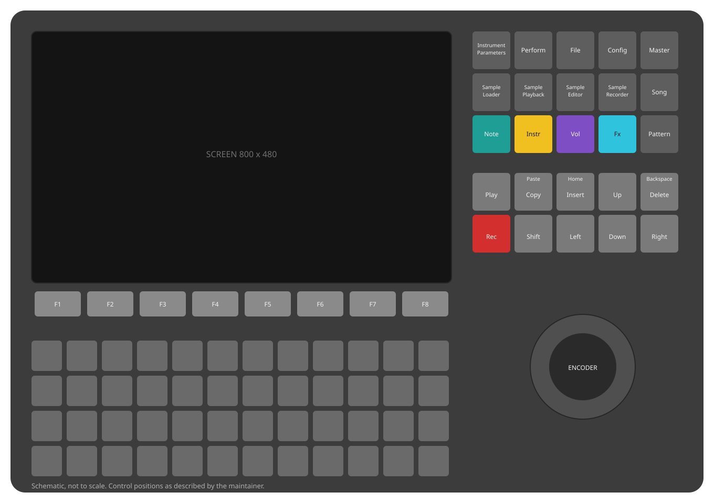
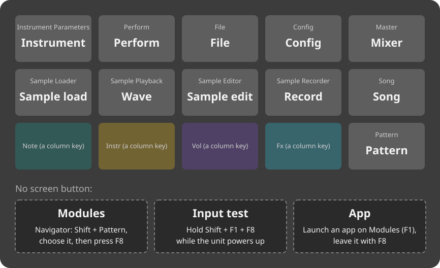
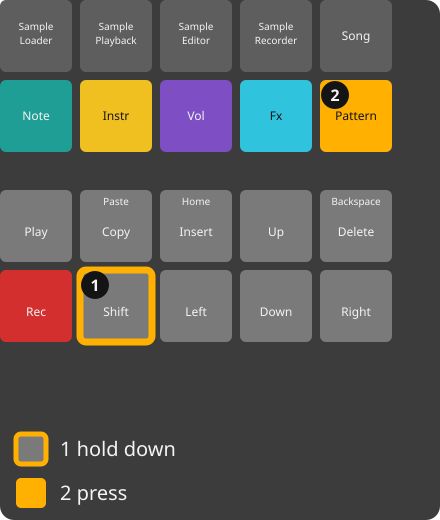
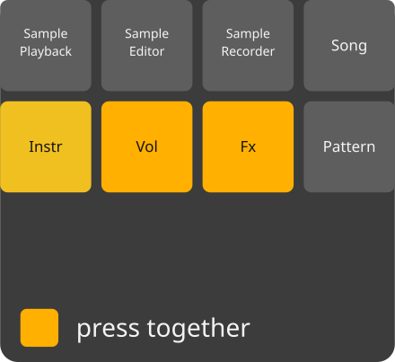
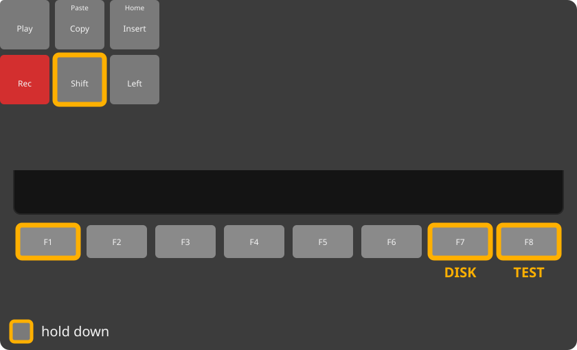

<!-- manual-sync: 48ab84b9 -->
# The panel

Status: draft

The panel page is the map of the unit: where each key is and what it does on every screen. Two things are worth knowing before you read on. `Shift` relabels the soft keys `F1` to `F8`, and the unit draws that second row while you hold it. The keys you hold while the unit turns on choose a start mode, such as the USB disk. Not checked against the original firmware: the key layout. <!-- og: open -->
<!-- Five pictures on purpose: the panel, the screen map and three chord figures (Learn, Navigator, the keys held at power-up), each with its `extra =` reason in diagrams.txt. panel.md is the key reference: the skill sanctions it above the cap of a task chapter. -->

## What it is for

Use this page to find a key on the unit and to see what it does. Read it when a chapter says "press `Shift` + `F3`" and you do not know where the key is.

*The drawing is schematic and not to scale.*

## The parts

The screen is at the top left. Under it are eight soft keys, `F1` to `F8`. Each soft key runs the label printed on the screen above it, so the labels change from one screen to the next. Under the soft keys is a grid of 48 pads: 12 columns and 4 rows.

The block at the top right holds the screen buttons. Each one opens a screen, and pressing it again opens the next page of that screen. Below that block is the edit and transport block, and at the bottom right is the encoder.

Holding `Shift` changes what the other keys do. `Shift` relabels `F1` to `F8`: while it is held, the key row shows the second labels of the screen. `Shift` + a soft key runs that label. In this manual, `Shift` + `F3` means: hold `Shift`, press `F3`, then release both.

## Keys on the screen (F1 to F8)
<!-- sync: src=app/include/o3os/app/mixer_view.h,app/src/bindings.cpp qa=QA-PAT-086,QA-PAT-089,QA-GLB-013 -->

Each soft key does what its label says on the screen in view. These are examples from two screens.

| Key | On Pattern | On Mixer | Ref |
|---|---|---|---|
| `F1` | opens the PATTERN chooser while you hold it (a tap does nothing) | shows the MIXER page | - |
| `F2` | opens the LENGTH chooser | shows the ROUTING page | - |
| `F3` | opens the JUMP chooser | shows the MST FX page | - |
| `F4` | **FILL**: opens the Fill dialog | shows the STEMS page | QA-PAT-086 |
| `F5` | **PREVIEW** | **CUE LVL**: goes to the cue level | - |
| `F6` | **INVERT** | - | - |
| `F7` | **TOOLS**: opens the tools list | **MUTE**: mutes the track under the cursor | - |
| `F8` | **UNDO** (`Shift` + `F8` is **REDO**) | **SOLO**: solos the track under the cursor | QA-PAT-089 |

If a `Shift` + soft key has no label, it does nothing. It never acts as the plain key. <!-- QA-GLB-013 -->

## Screen buttons
<!-- sync: src=app/src/bindings.cpp qa=QA-GLB-141,QA-GLB-153,QA-GLB-155,QA-GLB-157 -->

| Key | Opens | Ref |
|---|---|---|
| `Instrument Parameters` (`Params`) | the Instrument screen | - |
| `Perform` | the Perform screen | - |
| `File` | the File screen | - |
| `Config` | the Config screen | - |
| `Master` | the Mixer, when you let go of the key. Held, with the encoder: the master volume, on any screen ([Mixer](mixer.md)) | - |
| `Sample Loader` | the Sample load screen | - |
| `Sample Playback` | the Wave and Chop screen | - |
| `Sample Editor` | the Sample edit screen | - |
| `Sample Recorder` | the Record screen | - |
| `Song` | the Song screen, when you let go of the key. Held: the Song screen until you let go, then back to where you were ([Song](song.md)) | - |
| `Pattern` | the Pattern screen, when you let go of the key. Held, with the encoder: the tempo, on any screen; held, with a pad: tap tempo (see [Tempo from any screen](#tempo-from-any-screen)) | QA-GLB-153, QA-GLB-155 |
| `Shift` + `Pattern` | opens the Navigator; press `F8` (**GO**) to go to the screen you chose, or `F7` (**CLOSE**) to leave it | - |
| `Shift` + `Master` | steps to the next colour theme: Amiga, Black, White, then Amiga again. The THEME row on Config says the same. New in track3r-os. Not yet checked on the unit. | QA-GLB-157 |
| `Shift` + `Config` | opens the help page of the screen you are on (see [The help page](#the-help-page)) | QA-GLB-141 |

## Tempo from any screen
<!-- sync: src=app/src/bindings.cpp qa=QA-GLB-153,QA-GLB-154,QA-GLB-155 -->

New in track3r-os. Not yet checked on the unit. Hold `Pattern` on any screen and the encoder and the pads set the tempo. The screen does not change.

- **Turn the encoder** while you hold `Pattern`: the tempo moves 1 BPM a detent, between 40 and 800 BPM. Hold `Shift` first, then `Pattern`, and a detent is a tenth of a BPM. The sequencer follows at once, also while it plays, and the strip says, for example, **TEMPO 137.0 BPM**. <!-- QA-GLB-153 -->
- **Tap pads** while you hold `Pattern`, about half a second apart. The first tap says **TAP**. From the second, the tempo is the mean of the last four gaps, to a tenth of a BPM, between 40 and 300 BPM, and the strip says, for example, **TAP 120.0 BPM**. A pause of more than 2 seconds starts a new series. The pad plays no note. With `Pattern` up, a pad is a pad again. <!-- QA-GLB-154 -->

The turns and taps of one hold are one undo step on the screen in view: one `Undo` brings back the tempo from before the hold. Letting go of `Pattern` after a turn or a tap opens nothing. `Shift` pressed after `Pattern` ends the gesture, and the turn is the screen's own.

Nothing happens in a dialog or the Navigator, on a module app's page, or when CLOCK MODE is **Slave**: there the strip says **MIDI SLAVE: THE CLOCK SETS THE TEMPO**. `Master` + the encoder is unchanged.

A tap of `Pattern` with no turn or pad acts when you let go of the key, and so does `Shift` + `Pattern`, because `Pattern` now waits for a turn or a pad. A long hold with no turn is still a tap. Inside the Navigator, `Pattern` closes it at the press as before. <!-- QA-GLB-155 -->

## The help page
<!-- sync: src=app/src/bindings.cpp,app/src/help_actions.cpp qa=QA-GLB-141,QA-GLB-142,QA-GLB-143,QA-GLB-144,QA-GLB-145,QA-GLB-146,QA-GLB-147,QA-GLB-148,QA-GLB-149,QA-GLB-150,QA-GLB-152 -->

New in track3r-os. Not yet checked on the unit. Hold `Shift` and tap `Config` on any screen to read about it without leaving it.

1. Hold `Shift` and tap `Config`. A page titled **HELP: SONG** (for the Song screen) opens over the screen, with a page count such as **3/15** at the right of its bar. The key row reads **CLOSE** on `F8` and is blank otherwise. <!-- QA-GLB-141 -->
2. Press `Left` or `Right` to turn the pages. They stop at **1/15**, the Global page (the screen buttons and the global keys), and at **15/15**. <!-- QA-GLB-142 -->
3. Press `Up` or `Down`, or turn the encoder, to scroll one line. With `Shift` held they scroll a screenful. `Shift` alone neither scrolls nor closes. <!-- QA-GLB-143 -->
4. Press any other key to close it. <!-- QA-GLB-144 -->

Every screen has a page of its own, with a paragraph, **KEYS** and **PADS**. Perform has two: **HELP: PERFORM** (10/15) and **HELP: PERFORM DJ** (11/15), and the page that opens is the one for the Perform page you are on. <!-- QA-GLB-148, QA-GLB-152 -->

- The key that closes help does nothing else: `Play` does not start the transport, a screen button does not change the screen, and an `F` key posts no label. A pad closes it and plays no note. <!-- QA-GLB-144, QA-GLB-146 -->
- A pad you hold when help opens still ends its note when you let go. That let-go does not close help. <!-- QA-GLB-146 -->
- Each page keeps its scroll. `Shift` + `Config` opens the page at the scroll you left it. The scrolls are kept in memory only, so every page starts at the top after a power cycle. <!-- QA-GLB-145 -->
- Under a dialog (Learn, the Navigator, a chooser, the on-screen keyboard) `Shift` + `Config` does nothing. Close the dialog first. <!-- QA-GLB-147 -->
- On a module app's page, help opens over the app. The app hears nothing while the page is up, and takes input again after it closes. <!-- QA-GLB-150 -->

## Column and colour keys
<!-- sync: src=app/src/bindings.cpp -->

These four keys select a column of the Pattern grid. They work on the Pattern screen.

| Key | Colour | What it does on Pattern | Ref |
|---|---|---|---|
| `Note` | teal | selects the Note column; hold it to open the note popup | - |
| `Instr` | yellow | selects the Instr column; hold it to open the instrument list | - |
| `Vol` | purple | selects the volume column. The step grid calls this column **VOL**. Hold the key to open its popup. | - |
| `Fx` | cyan | selects the FX column; hold `Fx` and turn the encoder to change the FX type | - |

Press `Vol` and `Fx` together to open Learn.

## Edit block
<!-- sync: src=app/src/step_actions.cpp,app/src/bindings.cpp qa=QA-PAT-007,QA-PAT-319,QA-PAT-320,QA-PAT-321,QA-SNG-003,QA-SNG-012,QA-SNG-028,QA-SNG-053,QA-SNG-054,QA-SNG-056,QA-SNG-057,QA-SNG-058,QA-GLB-014 -->

Each key has a second label printed on it. `Shift` + the key runs that label.

| Key | Plain behaviour on Pattern | `Shift` + key | Ref |
|---|---|---|---|
| `Copy` (second label: Paste) | copies the selected block, or the step under the cursor; with `F1` held, the whole pattern | `Shift` + `Copy` pastes the clipboard at the cursor; with `F1` held, it writes a whole-pattern copy over the pattern shown | - |
| `Insert` (second label: Home) | inserts an empty step at the cursor and pushes the steps below it down. With a block selected, it works from the block's first step, on every track of the block | `Shift` + `Insert` goes to step 0 and clears the block selection | - |
| `Delete` (second label: Backspace) | clears what the cursor column holds: the whole step in Note or Instr, the volume in Vol, the FX in Fx. With a block selected, it clears the highlighted columns, or whole steps when the block spans tracks. | `Shift` + `Delete` removes the step under the cursor and pulls the steps below up, to close a gap. It is the reverse of `Insert`, and works from the block's first step when a block is selected. | - |
| `Up`, `Down`, `Left`, `Right` | move the cursor | `Shift` + `Up` or `Down` selects the block; `Shift` + `Left` or `Right` grows a block of columns one column at a time; past the last column it takes the next track whole | QA-PAT-007, QA-PAT-319 |

A block can cover just some columns of one track. `Delete` and `Copy` then act on those columns only, while Fill and the TOOLS list always take whole steps, and the strip says **WHOLE STEPS** when they do. <!-- QA-PAT-320, QA-PAT-321 --> See [Pattern](pattern.md).

On the Song screen, `Insert` adds a slot, `Shift` + `Insert` adds a slot with a copy of the pattern, and `Delete` removes the slot, or clears the selected cells when the cursor is in the track map. `Shift` + `Delete` cuts instead: the slot (or the selected slots) goes into the slot clipboard and out of the list, and in the track map the selected cells go into the song clip and are cleared; `Shift` + `Copy` puts them back anywhere. Hold `Copy` and press `Up` or `Down` to move the slot (or the selected slots) one place, and keep the arrow held to go on. `Note` jumps to the next slot that holds the same pattern, and `Shift` + `Note` to the previous one. The cut, the move and the jump are new in track3r-os. On lists, `Shift` + `Up` and `Shift` + `Down` move one page. <!-- QA-SNG-003 --> <!-- QA-SNG-012 --> <!-- QA-SNG-028 --> <!-- QA-SNG-053 --> <!-- QA-SNG-054 --> <!-- QA-SNG-056 --> <!-- QA-SNG-057 --> <!-- QA-SNG-058 --> <!-- QA-GLB-014 -->

The second label Backspace is not what `Shift` + `Delete` does on Pattern: it pulls steps up and erases nothing backwards. The backspace is the plain `Delete` key on the on-screen keyboard. The pull is new in track3r-os.

Most screen buttons act when you press them. `Pattern`, `Song` and `Master` act when you let go, because a hold can mean something else: `Shift` + `Pattern` opens the Navigator, and a hold of `Song` for 0.4 seconds shows the Song screen as a peek. <!-- QA-MIX-031, QA-SNG-060, QA-SNG-061 --> Playback does not stop when you change screen. Leaving Perform ends its effects, except when you go to the Mixer or Song; see [Perform](perform.md). <!-- QA-PRF-011 -->

The buttons have no lights. The screen shows the state instead, for example the mode chip and the red **REC** badge on Pattern. <!-- QA-PAT-001 -->

Some keys act on a tap and some only while you hold them. On Pattern, `F1` opens the pattern picker only while you hold it, so a tap opens nothing. On Pattern, `F2` and `F3` toggle a chooser with a tap. On Song, `F7` selects the tempo field, and a second tap taps the tempo. On the Mixer, `F1` on the MIXER page changes nothing. <!-- QA-MIX-032 -->

While a dialog or a list is open, it owns the key row: the row shows only the dialog's own keys, every other key is blank and does nothing, and `Shift` does not change the row. `F8` goes back. On the on-screen keyboard, `F8` keeps the text and `F7` cancels. Learn shows **BACK** on `F8` alone until it has a target or a binding. Fill shows **FILL** on `F1` and **BACK** on `F8`, and a running WAV export shows **CANCEL** on `F8`. The Navigator reads **GO** on `F1`, **CLOSE** on `F7` and **GO** on `F8`; with `Shift` held it reads only **CLOSE** and **GO**. The screen buttons do nothing until the dialog closes. New in track3r-os. Not yet checked on the unit. On Song, a question on the strip asks **ALL** (`F1`) or **UNIQUE** (`F2`), and any other key withdraws it. On Config, **APPLY** and **DEFAULTS** ask for a second press within a short time. <!-- QA-GLB-118, QA-GLB-119, QA-INS-050 -->

## Transport

| Key | Plain behaviour | `Shift` + key | Ref |
|---|---|---|---|
| `Play` | starts or stops the pattern you edit, from any screen | on Pattern, plays from the cursor's row | QA-PAT-126 |
| `Rec` | on Pattern, turns STEP editing on or off; on the Record screen, starts or stops the take | `Shift` + `Rec` turns LIVE recording on or off | QA-PAT-001 |

On Pattern, STEP lets you enter notes at the cursor while the pattern plays. LIVE records the notes you play at the play line. <!-- QA-PAT-002 --> <!-- QA-PAT-003 -->

## Pads
<!-- sync: src=app/include/o3os/app/pad_layer.h qa=QA-PAT-006,QA-PAT-313,QA-PAT-314 -->

| Pads | What they do on Pattern | Ref |
|---|---|---|
| the 48 pads, mode NOTES (the default) | preview the sound in WATCH; write a note at the cursor in STEP | QA-PAT-006 |
| `Shift` + `F1` | the pads' octave: the lowest C of the pads goes up one octave, C9 goes back to C0. The key shows the octave, and the octave is saved with the project. New Community OS behaviour. | QA-PAT-313 |
| `Shift` + `F2` to `F7` | choose the pad mode: `F2` NOTES, `F3` PIANO, `F4` ISO, `F5` TRACKS, `F6` PATS, `F7` VU | QA-PAT-314 |
| `Shift` + `F8` | redoes | QA-PAT-314 |
| `Shift` held alone | the pads show the TRACKS layer while you hold it: each column is a track, with rows for track, mute, mute mode and solo. New Community OS behaviour. | - |

The pad mode stays until you change it and is not saved.

## Encoder
<!-- sync: src=app/src/bindings.cpp qa=QA-GLB-159 -->

| Control | What it does | Ref |
|---|---|---|
| turn the encoder | changes the value under the cursor, or scrolls the list in view | - |
| `Shift` + turn the encoder | a coarse step on the Instrument screen; a fine step on the Song screen | - |
| turn the encoder quickly in a list | in File, Sample load, the Modules list and the module picker, a quick spin moves 4 rows a detent, then 8; a slow turn moves one. The Pattern cursor, every value and the `Shift` coarse steps are unchanged. New in track3r-os. Not yet checked on the unit. The numbers are being tuned. | QA-GLB-159 |

The encoder has no push function.

## Screenshot
<!-- sync: src=platform/mk66/usb/include/o3os/platform/mk66/usb/screenshot_service.h,core/include/o3os/core/power_hold.h qa=QA-GLB-130,QA-GLB-131,QA-GLB-132,QA-GLB-133,QA-GLB-134,QA-GLB-135,QA-GLB-136,QA-GLB-137,QA-GLB-138,QA-GLB-139,QA-GLB-140 -->

`Shift` + `Power` saves what is on the screen to the card as a picture. New in track3r-os. Not yet checked on the unit.

1. Put a card in the unit. Hold `Shift`, press `Power`, and let go of both. <!-- QA-GLB-130 -->
2. The screen freezes for 1 to 2 seconds while the picture is written. The song plays on with no click or stutter. <!-- QA-GLB-138 -->

You should see **SCREENSHOT SAVED: SHOT_0001.BMP** in the strip. The file is `Screenshots/SHOT_0001.bmp` on the card, 768,066 bytes. The next one is `SHOT_0002.bmp`, and no file is ever overwritten. A gap left by a deleted file is used only after 9999. <!-- QA-GLB-130, QA-GLB-131 -->

The picture shows the whole 800 x 480 screen as it is with no key held, so the key row has its plain labels, not the `Shift` labels. <!-- QA-GLB-132 --> Keys, pads and the encoder do nothing while the screen is frozen, and a pad you hold keeps its note until you let go. <!-- QA-GLB-140 -->

The strip says why when it cannot save, and writes no file:

| The strip says | Why |
|---|---|
| **NO SCREENSHOT: NO CARD** | there is no card in the unit |
| **NO SCREENSHOT: CARD ON THE COMPUTER** | the computer has the card, as in [USB disk](usb_disk.md) |
| **NO SCREENSHOT: CARD BUSY** | an export or a save is running |
| **NO SCREENSHOT: CONSOLE SHOT RUNNING** | a picture is being taken from the computer |
| **SCREENSHOT FAILED** | the card was pulled during the write; no `SHOT_nnnn.bmp` is left |

<!-- QA-GLB-133, QA-GLB-134, QA-GLB-135, QA-GLB-136, QA-GLB-139 -->

`Power` held alone still turns the unit off, and `Shift` pressed during that hold cancels it with no screenshot. <!-- QA-GLB-137 --> To take the picture from a computer instead, see [Computer tools](computer_tools.md).

## Power

`Power` is the small button on the rear panel. Hold it for 2 seconds to turn the unit off. Step by step, see [Getting started](getting_started.md#turn-the-unit-off). New in track3r-os. The hold time, the off state and the wake are not checked against the original firmware.

| Key | What it does | Ref |
|---|---|---|
| `Power`, held | a line across the top fills over 2 seconds, and the strip says **HOLD TO SWITCH OFF**. The line is drawn over a dialog too. Let go before it is full, and the line empties. The unit stays on, and the music keeps playing. | QA-GLB-100 |
| `Power`, a tap under 150 ms | nothing | QA-GLB-101 |
| `Power`, let go from 150 ms to 2 seconds | the strip shows **HOLD POWER 2 S TO SWITCH OFF** for about 1.5 seconds | QA-GLB-101 |
| `Shift` + `Power` | a screenshot ([above](#screenshot)). No line, no hint and no off. | QA-GLB-110, QA-GLB-130 |
| `Power` held, then `Shift` | the line empties and the unit stays on. To turn it off, let go of `Power` and hold it again. | QA-GLB-110 |

When the line is full, the strip says **POWERING OFF**. The keys, the pads and the MIDI input stop working, the screen fades, the pad lights go out and the sound stops. If a song is playing, the unit sends note-offs and a MIDI Stop to the MIDI out, and the sound fades in about 50 ms. Not yet checked on the unit. The unit is dark and silent, but it is not switched off at the power supply. To remove all power, unplug the USB cable. <!-- QA-GLB-102, QA-GLB-105, QA-GLB-117 -->

If `Power` is still held when the line is full, the unit goes dark at once and stays dark after you let go. <!-- QA-GLB-114 -->

**To start it again,** press `Power` and let go. The unit starts as after a power-up: the logo, then the project on the card. Nothing from before the off is kept, so work that was not saved is lost. Unplugging the USB cable and plugging it in again also starts the unit. <!-- QA-GLB-103 -->

If `Power` is held when the unit starts, the hold does not count until you let go. <!-- QA-GLB-104 -->

The off does not save for you. This is what happens to work in progress:

- **Unsaved work.** While the line fills, the strip says **UNSAVED WORK - LET GO TO KEEP IT** if the project has changes that are not saved, or if a recorded take or loop is not saved. Let go to keep working. After a save, the strip says **HOLD TO SWITCH OFF**. The off never saves for you, so a take or loop that is not saved is lost. <!-- QA-GLB-109 -->
- **A save in progress.** The save gets up to 5 seconds to finish, and the strip says **SAVING... THEN POWER OFF**. A save that is still running after that is cancelled, and the strip says **SAVE CANCELLED - POWERING OFF**. The old project file stays whole. A Config change that is not written yet is written first. <!-- QA-GLB-106, QA-GLB-107 -->
- **An export.** The first hold is refused, and the strip says **EXPORT RUNNING - HOLD POWER AGAIN TO STOP IT**. The export goes on. A second full hold within 10 seconds stops the export and turns the unit off. The finished files stay. A stopped export to the original firmware format has no project file, so it does not load as a project. See [File](file.md). <!-- QA-GLB-108 -->
- **A firmware update on the card.** Power is refused while the update runs, and the strip says **FIRMWARE UPDATE RUNNING**. The update is not touched. <!-- QA-GLB-112 -->
- **A writable disk.** When the card is shown to the computer as a writable disk, the first hold only warns, and the strip says **COMPUTER MAY BE WRITING - HOLD AGAIN**. A second full hold within 10 seconds turns the unit off. If you eject the disk on the computer first, one hold turns the unit off at once. The unit cannot flush the computer's write cache. See [Getting started](getting_started.md#use-the-card-on-a-computer). <!-- QA-GLB-111 -->

**Checked on a unit (test build v0.6.12):** the two-second hold turns the unit off, and the screen goes dark and silent. A press of `Power` starts it again, and so does plugging the USB cable in again. <!-- QA-GLB-102, QA-GLB-103, QA-GLB-117 -->

**Known gap:** a click may be heard at power off and at power on. <!-- QA-GLB-102, QA-GLB-103 -->

**Not yet checked on the unit:** the short-press hint, a hold that is still going when the line is full, the rule for a hold at start-up, `Shift` to cancel, saves and exports during an off, the firmware update refusal, the writable disk, and the current draw while the unit is off. <!-- QA-GLB-101, QA-GLB-104, QA-GLB-106, QA-GLB-107, QA-GLB-108, QA-GLB-109, QA-GLB-110, QA-GLB-111, QA-GLB-112, QA-GLB-114, QA-GLB-117 -->

## Keys held when the unit turns on

The unit reads these keys when it starts. Hold them while you turn the unit on, until the strip shows the mode.

| Keys held together | What happens | Ref |
|---|---|---|
| `Shift`, `F1` and `F7` | the card shows on the computer as a writable disk. See [Getting started](getting_started.md) | QA-GLB-015, QA-GLB-016 |
| `Shift` and `F1`; `Shift` and `F7`; `F1` and `F7` | the unit starts as normal | QA-GLB-016 |
| `Shift`, `F1` and `F8` | the **INPUT TEST** screen opens. `F7` held as well changes nothing | QA-GLB-015, QA-GLB-016 |
| `Shift`, `F1`, `F7` and `F8` | the **INPUT TEST** screen opens | QA-GLB-016 |

## See also

- [Mixer](mixer.md): the soft keys of the Mixer in detail.
- [Song](song.md): the slot keys and the order list.
