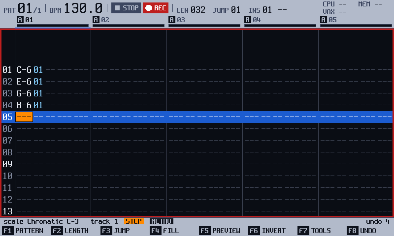
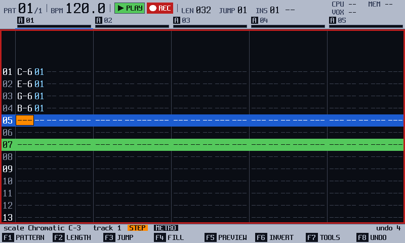
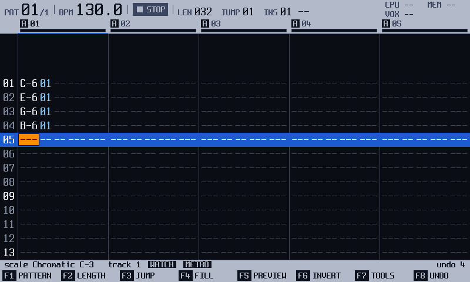
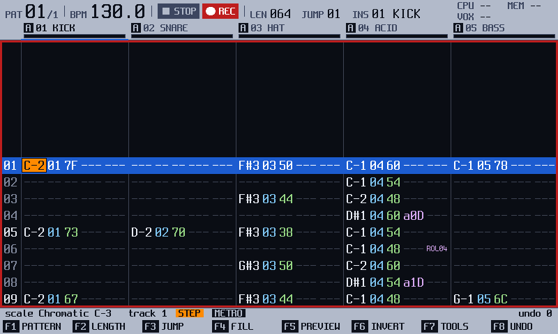
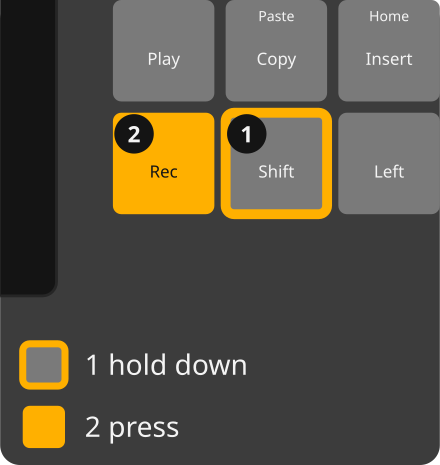
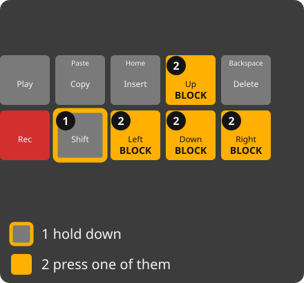
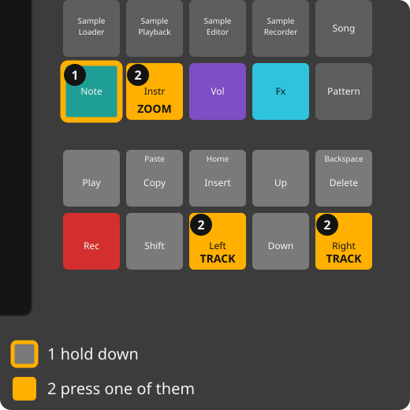

<!-- manual-sync: 48ab84b -->
<!-- Sources: docs/qa/catalogue/pattern.md (QA-PAT-001..010, 092, 120, 126, 150..151, 216..229, 231..247, 250..264, 270..276, 285..288, 311..323), docs/qa/catalogue/global.md (QA-GLB-018), docs/qa/catalogue/modules.md (QA-MOD-002 for the Navigator), docs/ui/ui-map.md section 1 (Pattern row: keys without a catalogue row). -->
<!-- Written on own pages: FX cells (fx.md), FILL and TOOLS (pattern_tools.md), EXPORT (export.md). Not written here: the zoom details beyond the task (QA-PAT-237..243), and rows with no user-visible text (QA-PAT-103, 115, 149 and 263: CPU cost; 245: a hardware-only tap check; 163: the tool apps' block context, on the tools page). -->
<!-- Open rows, not written: QA-PAT-030..049 and the other IDs missing from the catalogue (no rows yet). -->
# Pattern

Status: draft

Pattern has three record modes where the official firmware has one edit switch: `Rec` turns step entry on, and `Shift` + `Rec` turns live recording on. While a pattern plays you hold `F1` and pick another pattern, which takes over at the next step with no stop. A zoom shows up to 12 tracks. <!-- og: different --> The pad layouts of the `Shift` row, such as a piano or a pattern picker, the quarter jumps and blocks of single columns are new in track3r-os. <!-- og: new -->

## What it is for

Use Pattern to write the notes of the current pattern, live or one step at a time, and to copy, delete and undo parts of it. Open it with the `Pattern` button. A **step** is one row of the grid, and a **track** is one column group; see the [glossary](glossary.md). A pattern has 16 tracks. The zoom shows 5, 8 or 12 of them: hold `Note` and tap `Instr` to change it. Each track has columns for the note, the instrument, the volume and two effects. <!-- QA-PAT-236 -->

## How it works
<!-- sync: src=app/src/pattern_actions.cpp,app/src/step_actions.cpp,app/src/bindings.cpp qa=QA-PAT-001,QA-PAT-003,QA-PAT-005,QA-PAT-006,QA-PAT-126,QA-PAT-150,QA-PAT-151 -->

The notes are stored: they live in the pattern, and they are saved with the project. What you do not store is the **record mode**, the answer to "what do the pads and `Play` do to the pattern right now?" The chip in the info line shows it. <!-- QA-PAT-001 -->

- **WATCH** is the browse mode. Pads only preview the sound, and nothing is written.
- **STEP** writes each pad you press on the cursor's step, then moves the cursor on by **JUMP**. The playhead does not move the cursor. `Rec` turns it on and off. <!-- QA-PAT-006 -->
- **LIVE** writes the pads you play at the playhead while the pattern plays, and the view follows the playhead. `Shift` + `Rec` turns it on and off, and so do `Rec` and then `Play`, tapped within a few hundredths of a second. <!-- QA-PAT-003, QA-PAT-005, QA-PAT-317 -->

Only a key press ends a mode, with one exception: when the song ends in LIVE, the chip goes back to WATCH and the take ends. STEP stays. <!-- QA-PAT-126, QA-PAT-150 --> In STEP and LIVE a red frame shows that the pattern can be edited. The buttons have no lights, so the chip and the red frame are the signs.

An example: press `Rec`, then pads 1, 5, 8 and 12. Four notes sit on four steps in a row, and the cursor waits on the fifth. Press `Rec` again: the chip reads WATCH, and the notes stay. A whole LIVE take is one undo step. <!-- QA-PAT-151 -->

## Try it
<!-- sync: src=app/src/step_actions.cpp,app/src/bindings.cpp qa=QA-PAT-001,QA-PAT-002,QA-PAT-006 -->

Start with a new project. To hear the notes, put a sample on instrument 1 (see [Sample load](sample_load.md)).

1. Press `Pattern`. The grid opens in **WATCH**.
2. Press `Rec`. The chip reads **STEP**, and a red frame shows. <!-- QA-PAT-001 -->
3. Press pad 1, pad 5, pad 8 and pad 12. Each note is written on the cursor's step, and the cursor moves on. <!-- QA-PAT-006 -->

   

4. Press `Play`. The header reads **PLAY**, and a green bar, the playhead, runs down the steps. The cursor stays put, and you hear the four notes if instrument 1 has a sample.

   

5. Press `Play` to stop, then `Rec`. The chip reads **WATCH**, and the four notes stay. <!-- QA-PAT-002 -->

   

## The screen at a glance

| Area | What it shows |
|---|---|
| Track headers | The number and name of each track, with its MUTE and SOLO tags. |
| Grid | One row per step. Each track has the columns **Note**, **Instr**, **Vol** and **Fx**. The cursor row is always the 8th of the 16 rows, also on the first and last step; the rows past the ends are blank. <!-- QA-PAT-270, QA-PAT-271 --> |
| Info line | The record mode chip (**WATCH**, **STEP** or **LIVE**), then the track and the pattern name, such as `P01 intro`. |
| Key row | `F1` to `F8`. `F1` to `F3` are **PATTERN**, **LENGTH** and **JUMP**. |
| Shift row | The labels drawn while `Shift` is held: the pad octave and layouts. |

## More tasks

### Record a part into a playing pattern

Start on the Pattern screen, in WATCH. The pattern can be stopped or playing.

1. Press `Shift` + `Rec`. The chip reads **LIVE**, in red. A stopped transport starts now, after the count-in when COUNT-IN is on. <!-- QA-PAT-003, QA-PAT-134 -->
2. Play the pads. The notes are written at the playhead. The cursor follows it, and the view keeps the playing row in the middle. <!-- QA-PAT-004, QA-PAT-272, QA-PAT-273 -->
3. Press `Shift` + `Rec` for STEP, or `Rec` for WATCH. `Play` stops the transport and ends the take. <!-- QA-PAT-005, QA-PAT-130, QA-PAT-132 -->

You should see the new notes in the grid.

### Select a block
<!-- sync: src=app/src/step_actions.cpp,app/src/bindings.cpp qa=QA-PAT-007,QA-PAT-226 -->

Start in STEP, WATCH (stopped or playing) or LIVE. A block is the steps and tracks you mark. Inside one track it can be just some columns: note with instrument (they go together), volume, FX1, FX2.

1. Hold `Shift` and press `Down`, `Up`, `Left` or `Right`. The block is highlighted from the cursor. <!-- QA-PAT-007 -->
2. Keep `Shift` and an arrow to extend the block. <!-- QA-PAT-226 -->
3. To mark columns, put the cursor on the first column you want, then hold `Shift` and press `Down` (more steps) or `Left` or `Right` (one column at a time). <!-- QA-PAT-319 -->

You should see the block over the steps and tracks you chose, and over just the columns you chose while it stays in one track. `Shift` + `Right` past the last column takes the next track whole; from there `Shift` + `Left` or `Right` add or drop a whole track at a time. <!-- QA-PAT-319 --> The playhead does not move it. While the view follows the playhead (WATCH playing, LIVE) the block starts at the step the playhead is on at your first arrow press, and the cursor stays on the playhead. <!-- QA-PAT-009, QA-PAT-010 --> `Delete` clears the highlighted columns and closes the block: every column for whole steps, only the note and instrument for a block in the Note column. `Shift` + `Insert` or a plain arrow also closes it.

### Copy and paste steps

Start in STEP, with a block selected or with only the cursor on a step.

1. Press `Copy`. The strip says **COPIED n STEPS**, or **COPIED 1 STEP** with no block. Nothing changes. <!-- QA-PAT-226 -->
2. Move the cursor to the new place.
3. Press `Shift` + `Copy`. The copy is written with its top-left step on the cursor. <!-- QA-PAT-227 -->

You should see the copied steps. A block of columns copies and pastes those columns only, in the same columns; the other columns under it stay. <!-- QA-PAT-320 --> The clip stays, so you can paste it again. Pasting past the last step or track cuts the rest. There is no cut key: copy, then delete. <!-- QA-PAT-228 --> In WATCH the copy works, but the paste writes nothing and the strip says **TURN EDIT ON**. A whole-pattern clip (the `F1` row of the keys table) pastes as steps only; the lengths and name stay the target's. <!-- QA-PAT-288 --> Fill, the TOOLS list (DUPLICATE, EXPAND, SHRINK), the tool apps and EXPORT SELECTION always take whole steps. With a block of columns, Fill and DUPLICATE say **WHOLE STEPS** in the strip. <!-- QA-PAT-321, QA-PAT-092 -->

> **Careful**: Paste writes over the steps under it. One `F8` (**UNDO**) takes it back. <!-- QA-PAT-227 -->

### Delete and pull steps

Start in STEP, with the cursor on a step.

1. Press `Delete`. The step under the cursor is cleared, and the cursor moves on by **JUMP**. <!-- QA-PAT-216 -->
2. Hold `Shift` and press `Delete`. The steps below move up over the step under the cursor. <!-- QA-PAT-217 -->
3. Press `Insert`, then `Shift` + `Delete`. The pattern is as it was before. <!-- QA-PAT-229 -->

Holding `Delete` clears one step after another; each is one undo step.

### Change values in big steps

`Shift` + turn the encoder moves in big steps; the plain encoder moves one step. <!-- QA-PAT-251, QA-PAT-252, QA-PAT-253 -->

| Where the cursor is | `Shift` + encoder, one detent |
|---|---|
| **Note** column | one octave |
| **Instr** column | 8 instruments (1 to 64) |
| **Vol** column | 10 (0 to 127) |
| **Fx** value | 16 |
| Browse (WATCH) | one page of 16 rows |

The values stop at their first and last entry. The **PATTERN**, **LENGTH** and **JUMP** choosers (hold `F1` to `F3`) move eight places a detent.

### Switch to another pattern while it plays

Start on the Pattern screen, with the transport playing. Use this to go from a verse to a break without a stop.

1. Hold `F1`. The strip shows **PATTERN** and the number in view. The pads light as in PATS: the playing pattern is bright, one with notes is dim, an empty one is dark. <!-- QA-PAT-254 -->
2. Holding `F1`, press a pad (pad 1 is pattern 1, up to 48), turn the encoder, or press `Up` or `Down`. `Left` and `Right` jump to the previous and next pattern that exists, skipping unused numbers. `Shift` + encoder moves eight patterns. <!-- QA-PAT-255, QA-PAT-256, QA-PAT-257, QA-PAT-311 -->
3. Let go of `F1`. The strip closes. The new pattern loops.

The playing pattern changes at the next step and goes on at the same row. Notes still sounding end. The last pick wins, and picking the pattern that plays takes back a pick that has not landed. An empty pattern works too: the strip says **EMPTY**, and nothing is created until you write a note. <!-- QA-PAT-264 --> When the song plays, the pick leaves the song and loops your pattern (**LEAVES THE SONG**); press `Play` to stop, then `Play` on the Song screen to start the song again. <!-- QA-PAT-259 --> When the transport is stopped or counting in, the pick only chooses the pattern to view and edit. <!-- QA-PAT-260, QA-PAT-261 -->

In LIVE the take goes on, and a note you play between the pick and the next step is refused with **THE PLAYHEAD IS IN ANOTHER PATTERN**. In PATS (`Shift` + `F6`) a pad queues the pattern for the end of the one that plays. <!-- QA-PAT-262, QA-PAT-264 --> The official firmware also switches while one plays, at once, with the `Pattern` button held. Here the held `F1` does it, at the next step. <!-- og: different --> With PAT SWITCH on **Pattern end** (Config, PATTERN page), a pick in the held `F1` chooser waits for the end of the pattern, as a PATS pad does: the pick is queued, the view follows the playing pattern once you let go, and the same pad again takes the queue back. <!-- QA-PAT-318 -->

### Show more tracks at once

The zoom cycles from 5 tracks to 8 and then to 12, and back to 5. Every level shows the same 16 rows, and the cursor row stays in the middle. <!-- QA-PAT-236, QA-PAT-274, QA-PAT-275 --> At the 5-track zoom an FX cell reads the effect's three capitals, such as `CHD`, `ARP` or `SLD`, with its value after them; the 8 and 12 zooms draw no FX. <!-- QA-PAT-316 -->

1. Hold `Note`, tap `Instr`, then let both go. The zoom changes. <!-- QA-PAT-236 -->
2. Hold `Note` and press `Right` or `Left` to move the cursor one whole track. Hold the arrow to repeat. <!-- QA-PAT-239 -->

A tap of `Note` selects the Note column; a hold of half a second opens the Note popup. <!-- QA-PAT-240 -->

### Open the Navigator
<!-- sync: src=app/src/bindings.cpp qa=QA-MOD-002,QA-GLB-018 -->

The Navigator is the list of screens. <!-- QA-MOD-002 -->

1. Hold `Shift`, press `Pattern`, and let both go. The Navigator opens (keys: [The panel](panel.md#screen-buttons)).
2. Turn the encoder to the screen you want. `Shift` + turn moves a page.
3. Press `F8` (**GO**). The screen opens. <!-- QA-MOD-002 QA-GLB-018 -->

`F1` also opens it. `F7` (**CLOSE**) or `Pattern` leaves without a change.

## Keys on this screen
<!-- sync: src=app/src/pattern_actions.cpp,app/src/step_actions.cpp,app/src/bindings.cpp,app/include/o3os/app/pad_layer.h qa=QA-PAT-001,QA-PAT-002,QA-PAT-130,QA-PAT-003,QA-PAT-005,QA-PAT-131,QA-PAT-004,QA-PAT-132,QA-PAT-231,QA-PAT-234,QA-PAT-219,QA-PAT-220,QA-PAT-221,QA-PAT-007,QA-PAT-006,QA-PAT-222,QA-PAT-224,QA-PAT-240,QA-PAT-236,QA-PAT-239,QA-PAT-244,QA-PAT-251,QA-PAT-252,QA-PAT-253,QA-PAT-216,QA-PAT-217,QA-PAT-229,QA-PAT-226,QA-PAT-227,QA-PAT-254,QA-PAT-255,QA-PAT-260,QA-PAT-086,QA-PAT-160,QA-PAT-161,QA-PAT-246,QA-PAT-315 -->

<!-- manual-tables: keys screen=pattern -->
The key row, and the row drawn while `Shift` is held. `-` means the key does nothing.

| Key | Label | With `Shift` |
|---|---|---|
| `F1` | **PATTERN** | **OCTAVE** |
| `F2` | **LENGTH** | **NOTES** |
| `F3` | **JUMP** | **PIANO** |
| `F4` | **FILL** | **ISO** |
| `F5` | **PREVIEW** | **TRACKS** |
| `F6` | **INVERT** | **PATS** |
| `F7` | **TOOLS** | **VU** |
| `F8` | **UNDO** | **REDO** |

<!-- /manual-tables -->

| Key | What it does | Ref |
|---|---|---|
| `Rec` | Turns STEP on and off (from WATCH). In LIVE it goes to WATCH. | QA-PAT-001, QA-PAT-002, QA-PAT-130 |
| `Shift` + `Rec` | Turns LIVE on and off. In LIVE it goes to STEP. | QA-PAT-003, QA-PAT-005, QA-PAT-131 |
| `Rec`, then `Play` at once | The same as `Shift` + `Rec`. | QA-PAT-317 |
| `Play` | Starts and stops the pattern. In LIVE the cursor follows the playhead. | QA-PAT-004, QA-PAT-132 |
| `Shift` + `Play` | Starts the pattern at the cursor's row. It never counts in. | QA-PAT-231, QA-PAT-234 |
| `Up`, `Down`, `Left`, `Right` | Move the cursor. `Up` on step 1 wraps to the last step. | QA-PAT-219, QA-PAT-220, QA-PAT-221 |
| `Shift` + arrows | Select a block. `Left` and `Right` add a column at a time inside a track. | QA-PAT-007, QA-PAT-319 |
| pad | In STEP, writes the note under the cursor; over a step that has a note it replaces the note and instrument and keeps the volume and effects. In the Instr column it picks the instrument instead (pad 10 is instrument 10) and the note stays. | QA-PAT-006, QA-PAT-222, QA-PAT-315 |
| `Note`, `Instr`, `Vol`, `Fx` | Select the column. Hold for the popup of that column. | QA-PAT-224, QA-PAT-240 |
| `Note` + `Instr` | Cycles the zoom: 5, 8 or 12 tracks. | QA-PAT-236 |
| `Note` + `Left` or `Right` | Moves one whole track. | QA-PAT-239 |
| `Shift` + `Note`, `Instr`, `Vol`, `Fx` | Jumps to a quarter of the pattern. | QA-PAT-244 |
| encoder | Changes the value under the cursor. | QA-PAT-251 |
| `Shift` + encoder | Moves in big steps. See the table above. | QA-PAT-251, QA-PAT-252, QA-PAT-253 |
| `Delete` | Clears the step. Hold to repeat. | QA-PAT-216 |
| `Shift` + `Delete` | Pulls the steps below up. Hold to repeat. | QA-PAT-217, QA-PAT-229 |
| `Insert` | In STEP. With `Shift` + `Delete` after it, leaves the pattern as it was. | QA-PAT-229 |
| `Copy` | Copies the block, or the step. | QA-PAT-226 |
| `Shift` + `Copy` | Pastes the clip at the cursor, in STEP. | QA-PAT-227, QA-PAT-288 |
| `F1` (**PATTERN**) | Hold: the chooser. Playing, a pick switches the pattern. A tap does nothing. With `F1` held, `Copy` copies the whole pattern and `Shift` + `Copy` writes it over the one shown. | QA-PAT-254, QA-PAT-255, QA-PAT-260, QA-PAT-285, QA-PAT-286 |
| `F2` (**LENGTH**), `F3` (**JUMP**) | Hold to open a chooser. | QA-PAT-253 |
| `F4` (**FILL**) | Opens the Fill dialog in Edit. | QA-PAT-086 |
| `F7` (**TOOLS**) | Opens the TOOLS list: EXPORT PATTERN, DUPLICATE x2, EXPAND x2, SHRINK /2, and the tool apps. While the view follows the playhead the strip says STOP PLAYING TO OPEN TOOLS. | QA-PAT-160, QA-PAT-161, QA-PAT-280 |
| `F8` (**UNDO**), `Shift` + `F8` (**REDO**) | Take back and redo the Pattern changes. | QA-PAT-246 |

`F5` (**PREVIEW**) sounds the note under the cursor while you hold it. `F6` (**INVERT**) reverses the steps of the block, track by track; with no block the strip says **SELECT A BLOCK TO INVERT**, and outside STEP and LIVE it says **TURN EDIT ON**. <!-- QA-PAT-312 --> A tap of `F2` or `F3` opens its chooser, and a second tap closes it. A chooser shows its own name on `F1` to `F3` with the open one inverted and **BACK** on `F8`; in the **PATTERN** chooser `F1` reads **PATTERN**, and in TOOLS `F1` reads **RUN**. The step popup shows **CANCEL** on `F8` alone. <!-- QA-PAT-276 -->

The Shift row sets the pads' octave and chooses what the pads do. The octave is the note-entry octave (saved with the project); the pad mode stays until you change it and is not saved. No key picks the STEP pad layout. New in track3r-os. <!-- QA-PAT-250 -->

| Key | Pads |
|---|---|
| `Shift` + `F1` (**OCTAVE**) | moves the pads' lowest C up one octave; after C9 it goes back to C0. The key shows the octave, for example **C3**. It applies to NOTES, PIANO and ISO |
| `Shift` + `F2` (**NOTES**) | the usual note pads |
| `Shift` + `F3` (**PIANO**) | two octaves laid out like a piano |
| `Shift` + `F4` (**ISO**) | each column a semitone, each row up a fourth |
| `Shift` + `F5` (**TRACKS**) | each column is a track; rows for track, mute, mute mode and solo |
| `Shift` + `F6` (**PATS**) | each pad is a pattern, 1 to 48. A tap queues it |
| `Shift` + `F7` (**VU**) | each column is a track with a level meter. Again: faders |

The octave is also the OCTAVE row of the note panel (hold `Note`) and the octave pads of PIANO: all three agree. <!-- QA-PAT-313, QA-PAT-314 --> A lone `Shift` held down shows the TRACKS layout until you let go.

## Good to know
<!-- sync: src=app/src/pattern_actions.cpp qa=QA-PAT-250,QA-PAT-251,QA-PAT-252,QA-PAT-253,QA-PAT-243,QA-PAT-246,QA-PAT-247,QA-PAT-052,QA-PAT-235,QA-PAT-057,QA-PAT-219,QA-PAT-221,QA-PAT-244,QA-PAT-254 -->

- `F1` **PATTERN** works only while you hold it, so a tap opens nothing. **JUMP** is the step value. The tempo is set with `Pattern` held and the encoder, on any screen. <!-- QA-PAT-086, QA-PAT-089 -->
- After `Play` stops in WATCH, the cursor stays on the last row it followed; it does not jump back or to the top. New in track3r-os. <!-- QA-PAT-322 -->
- In LIVE, the encoder and `Delete` edit the step under the playhead: the encoder moves its note by a semitone and `Delete` clears it. A plain arrow only moves the cursor one row off the playhead, changes no step, and the next step pulls the cursor back. The red **LIVE** chip is the only sign. New in track3r-os. <!-- QA-PAT-323 -->
- In the Instr column the encoder counts 1 to 48 and stops. One detent down from instrument 1 goes to 49, then on to 64 (MIDI channels 1 to 16); one detent up from 49 goes back to 1. <!-- QA-PAT-120 -->
- Undo works per screen: `F8` (**UNDO**) takes back the last change to the pattern and `Shift` + `F8` (**REDO**) redoes it. The strip says **NOTHING TO UNDO HERE** when none is left. A Song change is undone on Song. Making or deleting a pattern on Song clears the Pattern history (**PATTERN HISTORY CLEARED**). <!-- QA-PAT-246, QA-PAT-247 -->
- `Up` on step 1 goes to the last step; holding `Up` or `Down` stops at the ends. `Shift` + `Note`, `Instr`, `Vol` or `Fx` jumps to row 1, 17, 33 or 49 of a 64-step pattern. <!-- QA-PAT-219, QA-PAT-221, QA-PAT-244 -->
- Count-in: with COUNT-IN on (PATTERN page of [Config](config.md)), `Shift` + `Rec` from stopped counts in first. `Rec` or `Shift` + `Rec` during the count-in cancels it. `Play` never counts in. <!-- QA-PAT-052, QA-PAT-235, QA-PAT-057 -->
- The zoom is not saved with the project: it survives a project load and starts at 5 tracks at power on. <!-- QA-PAT-243 -->
- New in track3r-os: the pad layouts, the quarter jumps, column blocks and the FX names in the cells. <!-- og: new --> The official firmware has its own record edit, live recording, an instant pattern switch and a view of 4 tracks. Here they work as this chapter says. <!-- og: different --> Not checked against the original firmware: the grid, the cursor keys, the copy keys and the `Shift` + encoder steps. <!-- og: open -->
- Not yet checked on the unit: the record modes, copy and paste, column blocks, the `Rec` then `Play` chord, undo, the zoom and its FX names, the chooser labels, the `Shift` + encoder steps, and the switch with `F1` held. <!-- QA-PAT-001..010, QA-PAT-226..229, QA-PAT-251..253, QA-PAT-254..264, QA-PAT-276, QA-PAT-288, QA-PAT-316, QA-PAT-317, QA-PAT-318, QA-PAT-311, QA-PAT-319..323 -->

## See also

- [Effects in the pattern](fx.md): the effects in the Fx column, their values.
- [Fill and tools](pattern_tools.md): FILL, and the TOOLS list of apps.
- [Song](song.md): the order of the patterns, and the Song undo.
- [Instrument](instrument.md): the sound that a note plays, and its pages.
- [Export](export.md): WAV files of the song, a pattern, a block and the stems.
