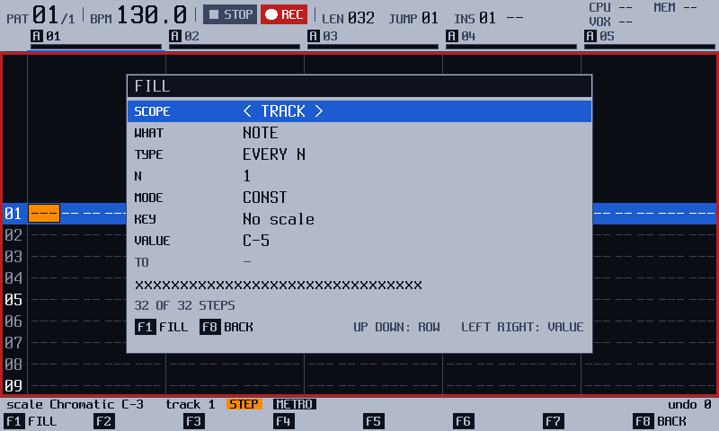
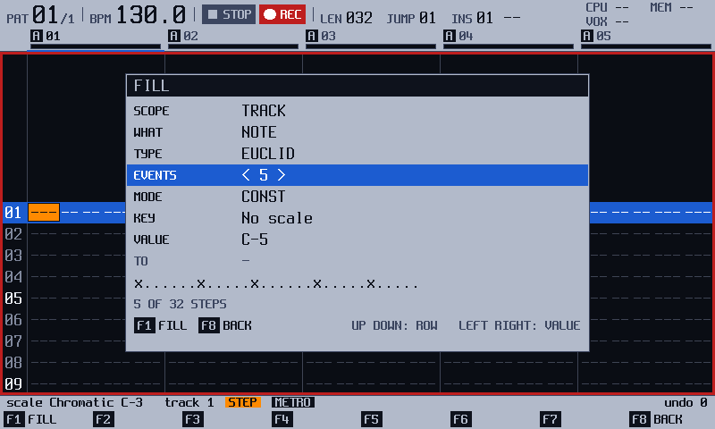
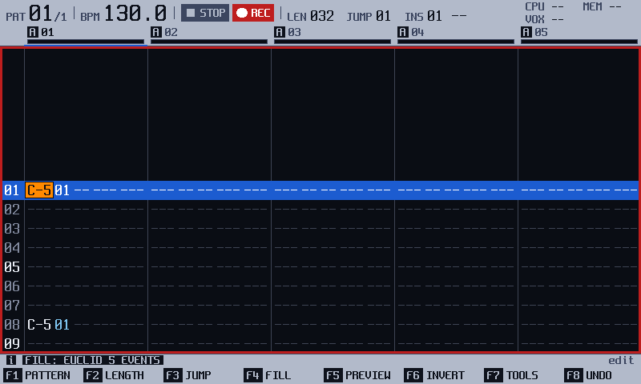
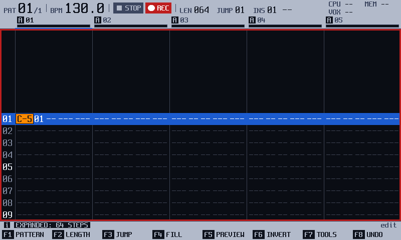
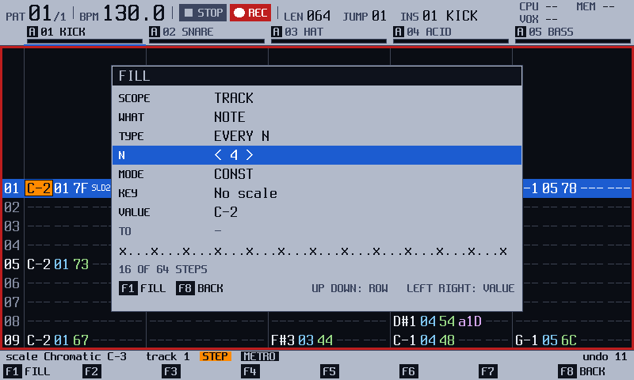
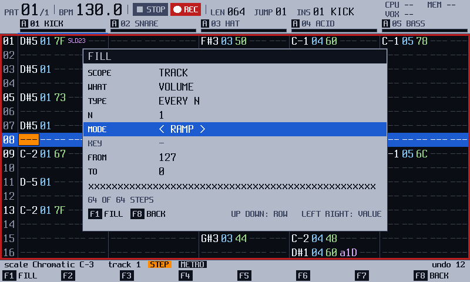

<!-- manual-sync: f5e29c02 -->
<!-- Sources: docs/qa/catalogue/pattern.md, QA-PAT-086..095 and 300..309 (Fill), QA-PAT-090 (Shift + Fx), QA-PAT-160..167, 210..213 and 280..289 (TOOLS, the length tools, the whole-pattern copy). Export entries (QA-PAT-180, 185..189) are in export.md. -->
<!-- Open rows, not written: none in these ranges. The IDs 030 to 049 of the Pattern catalogue are not in the catalogue. -->
# Fill and tools

Status: draft

These tools write a stretch of the pattern by a rule, where you would otherwise enter one step at a time. **FILL** (`F4`) writes notes, instruments, volumes or an effect on every Nth step, on a Euclid rhythm, on random steps or along a scale, with one value, along a ramp or at random. **TOOLS** (`F7`) lists three tools that double, spread or halve a pattern, and the apps on the card that edit the project. Holding `F1` with `Copy` copies one whole pattern onto another. The official firmware has a Fill dialog, duplicate, expand and shrink, and a whole-pattern copy too; here they work as this chapter says. <!-- og: different --> The apps in the TOOLS list are new in track3r-os. <!-- og: new -->

## What it is for

Use FILL to lay down a rhythm, a fade or a run of random notes in one go, then play with the result. Use TOOLS to change a pattern's length or to run an app on it. Both are on the [Pattern](pattern.md) screen, in STEP, with the transport stopped for the TOOLS list.

## How it works
<!-- sync: src=app/src/fill_actions.cpp,app/src/fill_view.cpp,app/src/tools_actions.cpp,app/src/pattern_ops_actions.cpp spec=docs/specs/OS-FILL2.md,docs/specs/OS-PTOOLS.md qa=QA-PAT-086,QA-PAT-088,QA-PAT-089,QA-PAT-160,QA-PAT-162,QA-PAT-166,QA-PAT-280,QA-PAT-285 -->

### What is a fill?

A fill is a rule plus a value. The rule picks which steps get something, and the value says what they get. It is like stamping a pattern of dots on a strip of paper, then choosing the colour of the ink.

The dialog is live, and it writes nothing. A line of steps under the rows shows the hits as **x**, with a count such as `4 OF 8 STEPS`. Nothing reaches the pattern until you press `F1` (**FILL**). Then the notes are stored in the pattern like any note, and the whole fill is one undo step. `F8` (**BACK**) leaves the dialog and ends it with no change. <!-- QA-PAT-086, QA-PAT-088, QA-PAT-089 -->

An example: choose EUCLID with 5 events and press `F1`. Five notes land spread as evenly as the track's steps allow, a rhythm you would not tap by hand. Press `F8` (**UNDO**) and the track is as it was.

### What are the rules and the values?

The **TYPE** row is the rule: <!-- QA-PAT-094, QA-PAT-305 -->

| TYPE | What it picks |
|---|---|
| EVERY N | Steps 1, N+1, and so on. |
| EUCLID | Exactly E hits, spread evenly. The gaps differ by at most one. If E is more than the steps, every step is filled. |
| RANDOM | **DENSITY** 0 picks none, 100 picks all, 30 picks about three in ten. |
| SCALE | The notes of the scale from FROM to TO, going up, then repeating. No note twice in a row. Never above note 127. |

The **MODE** row is the value. **CONST** writes one value (FROM). **RAMP** goes from FROM to TO over the hits, so a volume ramp from 127 to 0 is a fade-out. **RANDOM** picks a value from FROM to TO for each hit. **WHAT** chooses what is written: a note, an instrument, a volume, or the effect in **FX 1** or **FX 2**. **SCOPE** chooses the block, the track or the pattern. Each track counts its own steps, so its first step gets FROM and its last gets TO. <!-- QA-PAT-301, QA-PAT-306 -->

### What are the tools?

The TOOLS list holds three kinds of entry. The EXPORT entries are on [Export](export.md). The length tools, **DUPLICATE x2**, **EXPAND x2** and **SHRINK /2**, change a pattern's length in one press. The tool apps, such as RHYTHM GEN, are small programs on the card that write into the pattern. <!-- QA-PAT-160, QA-PAT-180 -->

A tool is stored when you run it: it edits the pattern at once, and one `F8` (**UNDO**) takes back the whole change. An app asks first (**EDITS THE PROJECT (UNDOABLE): F1 AGAIN**). Leave an app with `F7` and `F8` together. <!-- QA-PAT-162, QA-PAT-165, QA-PAT-166 --> For example, EXPAND x2 on a short pattern makes one twice as long, at half speed, with a gap between every note, ready to fill the gaps by hand.

## Try it
<!-- sync: src=app/src/fill_actions.cpp,app/src/fill_view.cpp,app/src/tools_actions.cpp,app/src/pattern_ops_actions.cpp qa=QA-PAT-086,QA-PAT-087,QA-PAT-088,QA-PAT-160,QA-PAT-280,QA-PAT-246 -->

1. Press `Pattern`, then `Rec`. The chip reads **STEP**.
2. Press `F4` (**FILL**). The Fill dialog opens. <!-- QA-PAT-086 -->

   

3. Press `Down` twice and `Right` twice, so TYPE reads **EUCLID**. Press `Down` and `Right` once more, so EVENTS reads 5. The line shows five hits. <!-- QA-PAT-087 -->

   

4. Press `F1` (**FILL**). Five notes are written, spread down the track, and the strip says **FILL: EUCLID 5 EVENTS**. The screen shows the first steps only, so you see the first two, on steps 1 and 8. <!-- QA-PAT-088 -->

   

5. Press `F7` (**TOOLS**). The list opens, with **EXPORT PATTERN** first, then the length tools. <!-- QA-PAT-160 -->
6. Press `Down` twice, to **EXPAND x2**, and `F1` (**RUN**). The track is twice as long, and the strip says **EXPANDED: 64 STEPS**. Each note sits twice as far from step 1, so step 8 is empty now. <!-- QA-PAT-280 -->

   

7. Press `F8` (**UNDO**). The length comes back, and `Play` gives you the five-note rhythm again. <!-- QA-PAT-246 -->

## The screen at a glance

| Row | What it sets |
|---|---|
| SCOPE | **BLOCK**, **TRACK** or **PATTERN**: where the fill goes. |
| WHAT | **NOTE**, **INSTR**, **VOLUME**, **FX 1** or **FX 2**: what the fill writes. |
| TYPE | **EVERY N**, **RANDOM**, **EUCLID** or **SCALE**: the rule. |
| N | The step count for EVERY N and SCALE. It reads **EVENTS** for EUCLID, and **DENSITY** for RANDOM: how many steps get a value, from 0 to 100. |
| MODE | **CONST**, **RAMP** or **RANDOM**: the value. |
| KEY | For NOTE: the scale and its root in one row, such as `C# Dorian`. For FX 1 and FX 2 it reads **FX TYPE**: the effect to write. |
| FROM, TO | The value, or the two ends of the ramp or the range. FROM reads **VALUE** in CONST, where TO is dim. |

The rows that do not apply are dim. MODE is dim for NOTE with RANDOM or SCALE: those two rules choose the notes, and FROM and TO then set the window of notes they choose from. KEY is dim for INSTR and VOLUME. The dialog opens with FROM and TO taken from the cursor step: the note under it and an octave above, the instrument in hand, its volume (else 127) down to 0, or its FX type. The key row reads **FILL** on `F1` and **BACK** on `F8`. <!-- QA-PAT-300, QA-PAT-305, QA-PAT-308, QA-PAT-309, QA-PAT-091 -->

## More tasks

### Fill a track with a rule

Start on the Pattern screen, in **STEP**. Put the cursor on the track.

1. Press `F4` (**FILL**). <!-- QA-PAT-086 -->
2. Press `Down` to a row, then `Right` to change it. Set TYPE to the rule. <!-- QA-PAT-087 -->
3. Set N, DENSITY or EVENTS. For a note fill, set KEY to a scale: `Right` steps the scale, `Shift` + encoder steps the root. <!-- QA-PAT-094, QA-PAT-304 -->
4. Press `F1` (**FILL**). <!-- QA-PAT-088 -->

You should see the notes on the steps the rule picks. In WATCH the strip says **FILL: TURN EDIT ON**. <!-- QA-PAT-093 -->

### Fade a track out with a ramp

Start on the Pattern screen, in **STEP**. Put the cursor on the track.

1. Press `F4` (**FILL**). Set WHAT to **VOLUME** and MODE to **RAMP**. FROM reads 127 and TO reads 0. <!-- QA-PAT-300 -->

   

2. Set TYPE to **EVERY N** and N to 1.
3. Press `F1` (**FILL**). <!-- QA-PAT-301 -->

You should see the volume column fall from 7F to 00 over the track, and the strip says **FILL: EVERY 1 STEP, VOLUME RAMP 127-0**. Set FROM below TO to fade in. RAMP on a note moves it up into the scale of KEY, and RANDOM picks a note of that scale between FROM and TO, never the same one twice in a row. A note that cannot be placed at 127 or below leaves its step as it was. <!-- QA-PAT-301, QA-PAT-306 -->

### Fill an effect column

Start on the Pattern screen, in **STEP**. Put the cursor on the track.

1. Press `F4` (**FILL**). Set WHAT to **FX 1** or **FX 2**.
2. Set FX TYPE (the row under MODE) to the effect, such as **Chance**. FROM and TO go to that effect's default value. <!-- QA-PAT-302 -->
3. Set MODE, then FROM and TO. A value stays inside the range of the effect.
4. Press `F1` (**FILL**). <!-- QA-PAT-303 -->

You should see the effect and a value on every step the rule picks, such as **FILL: EVERY 1 STEP, FX 1 RANDOM 0-100**. A step that held another effect in that column gets the new one. The note, instrument, volume and the other FX column stay. <!-- QA-PAT-303, QA-PAT-307 --> If the cursor step has no effect in that column, FX TYPE starts on **Off**, and `F1` writes **Off** over the hits. One `F8` takes it back. <!-- QA-PAT-309 -->

### Fill only a block

Start on the Pattern screen, in **STEP**. Put the cursor on the first step of the block.

1. Hold `Shift` and press `Down` seven times. This selects eight steps. Started on one column, the block covers that column only. <!-- QA-PAT-091, QA-PAT-007 -->
2. Press `F4` (**FILL**). The SCOPE row reads **BLOCK**. <!-- QA-PAT-091 -->
3. Set TYPE to **EVERY N**, and N to 2. The line reads `x.x.x.x.` and the count reads `4 OF 8 STEPS`. <!-- QA-PAT-091 -->
4. Press `F1` (**FILL**). Steps 1, 3, 5 and 7 of the block get the note. Nothing outside the block changes. <!-- QA-PAT-092 --> A block that holds only some columns fills whole steps, and the strip begins **FILL: WHOLE STEPS**. <!-- QA-PAT-092, QA-PAT-321 -->

### Run a tool app

Start on the Pattern screen, with the transport stopped.

1. Press `F7` (**TOOLS**). The list opens. <!-- QA-PAT-160 -->
2. Press `Down` to the app, for example **RHYTHMGEN**. <!-- QA-PAT-210 -->
3. Press `F1` (**RUN**). The list says **EDITS THE PROJECT (UNDOABLE): F1 AGAIN**, and the key reads **RUN?**. Press `F1` again. <!-- QA-PAT-162, QA-PAT-276 -->
4. Work in the app, then press `F7` and `F8` together. You are back on the Pattern screen. <!-- QA-PAT-165 -->

An app opens on the block you selected. It gets whole steps: a block of only some columns reaches it as the whole steps of its rows and tracks. <!-- QA-PAT-163, OS-AUDIT-56 in app/src/tools_actions.cpp --> `F8` (**BACK**) closes the list without running anything. <!-- QA-PAT-276 -->

You should see the app's notes on the Pattern screen. One `F8` (**UNDO**) takes back everything the app wrote, and the strip says `UNDO RHYTHM GEN`. <!-- QA-PAT-166 --> The list shows the apps on the card that edit the project, sorted by name: <!-- QA-PAT-160 -->

| App | What the catalogue says |
|---|---|
| RHYTHM GEN | Works on the block, or on 16 rows from the cursor when no block is selected. Its last page (`Right` to SHARED) ends with the rows PATTERN, TRACK, ROW and ROWS, so you can move the target without leaving the app. `Delete` puts a row back to where you opened it. The rows are not remembered. <!-- QA-PAT-163, QA-PAT-164, QA-MOD-132 --> |
| HUMANIZE | Moves notes a little late, and makes their volume a little louder or softer, with a Micro-move in an FX column. The rows below SEED are its target: it starts at the block or the cursor. <!-- QA-PAT-211, QA-MOD-132 --> |
| CHORDS | On a MIDI track, writes root notes with a Chord effect. On a sample in spread mode, puts the chord's tones on three tracks. `Right` opens a second page with the target. <!-- QA-PAT-212, QA-MOD-132 --> |
| MORPH, MUTATE | Work on a whole instrument; see [Modules](modules.md#launch-an-app-on-the-pattern-you-are-editing). `F1` (**APPLY**) writes the change as one undo unit, and `F8` takes it back. MUTATE also has `F2` (**VARY**), which takes the next seed and applies it. MORPH has `F3` (**RESET**), which puts the instrument back as it was when the page opened. <!-- QA-MOD-071, QA-MOD-086, QA-MOD-088, QA-PAT-166 --> |
| TAPCALC | Measures a tempo from your taps. See [Modules](modules.md). <!-- QA-MOD-003 --> |

### Double, spread or halve a pattern

Start on the Pattern screen, with the transport stopped and Edit on (`Rec`).

1. Press `F7` (**TOOLS**). The list opens with **EXPORT PATTERN**, then **DUPLICATE x2**, **EXPAND x2** and **SHRINK /2**. <!-- QA-PAT-180 -->
2. Press `Down` to the tool you want.
3. Press `F1` (**RUN**). The list closes. With a block selected, the tool changes the tracks of the block. With none, it changes every track.

You should see the new length of the longest track in the strip, for example **EXPANDED: 64 STEPS**. Each track goes by its own length. <!-- QA-PAT-280 --> A block of only some columns counts as whole steps, and the strip ends **WHOLE STEPS**. <!-- QA-PAT-321 -->

| Tool | What it does |
|---|---|
| **DUPLICATE x2** | Doubles the length and repeats the steps. A 32-step track becomes 64, and steps 33 to 64 copy steps 1 to 32. <!-- QA-PAT-284 --> |
| **EXPAND x2** | Doubles the length and puts each step on every second row, with an empty step between. The pattern plays at half speed. <!-- QA-PAT-280 --> |
| **SHRINK /2** | Halves the length, rounding an odd length up, and keeps every second step. The pattern plays twice as fast. EXPAND then SHRINK gives the pattern back. <!-- QA-PAT-282 --> |

A result over 128 steps is refused: the strip says **TOO LONG: 128 STEPS AT MOST** and nothing changes. <!-- QA-PAT-281 --> In WATCH the strip says **TURN EDIT ON**. <!-- QA-PAT-283 --> Effects that count ticks, such as retrigger and arpeggio, keep their values: the notes move, but the ticks inside a step do not scale. <!-- QA-PAT-280 -->

### Copy a whole pattern onto another

Start on the Pattern screen, with Edit on.

1. Hold `F1`. The strip shows **PATTERN**, and now also **COPY: COPY** and **SHIFT+COPY: PASTE**. <!-- QA-PAT-285 -->
2. Pick the pattern to copy with a pad (pads 1 to 48 are patterns 1 to 48), the encoder, `Up` or `Down`. `Left` and `Right` jump to the previous and the next pattern the project has. Press `Copy`. <!-- QA-PAT-256, QA-PAT-311 -->
3. Pick the pattern to write over. A pattern the project does not have yet is made.
4. Press `Shift` + `Copy`, then let go of `F1`. <!-- QA-PAT-286 -->

You should see **PATTERN 07 REPLACED BY 05**. The target now has the steps, the length of every track and the name of the copy. One `F8` (**UNDO**) takes it all back, and removes a pattern that the paste made. <!-- QA-PAT-287 --> `Copy` works in every mode. The paste needs Edit, and says **TURN EDIT ON** without it. In the grid, `Shift` + `Copy` pastes a whole-pattern copy as a block, steps only, at the cursor and clipped at each track's end. The target keeps its lengths and its name. <!-- QA-PAT-288 --> You may paste over the pattern that plays: each track takes its new length from its next row, but the pass in progress ends at the old pattern length. <!-- QA-PAT-289 --> A MIDI note that sounds on a track the paste leaves empty may stay on until the transport stops (`Play`). Not yet checked on the unit.

At the first or last pattern, `Left` or `Right` says **NO PREVIOUS PATTERN** or **NO NEXT PATTERN** and changes nothing. While the transport plays, a pick also switches the playing pattern, as a pad pick does; with PAT SWITCH set to Pattern end it waits for the pattern's end. New in track3r-os. Not yet checked on the unit. <!-- QA-PAT-311, QA-PAT-318 -->

## Keys on this screen

| Key | What it does | Ref |
|---|---|---|
| `F4` (**FILL**) | Opens the Fill dialog in STEP. | QA-PAT-086, QA-PAT-093 |
| `Up`, `Down` | Choose a row in the Fill dialog. | QA-PAT-087 |
| `Right`, encoder | Change the value of the row. | QA-PAT-087, QA-PAT-253 |
| `Shift` + encoder | N moves four a turn. DENSITY moves ten a turn. FROM and TO move twelve for a note and ten for the rest. On KEY it steps the root. | QA-PAT-253, QA-PAT-308 |
| `F1` (**FILL**) | Fills the track, or the block when SCOPE is BLOCK. | QA-PAT-088, QA-PAT-092 |
| `F8` (**BACK**) | Leaves the Fill dialog without a fill. | QA-PAT-086 |
| `F7` (**TOOLS**) | Opens the list of tool apps. Refused while the view follows the playhead (the strip says STOP PLAYING TO OPEN TOOLS). | QA-PAT-160, QA-PAT-161 |
| `Up`, `Down`, encoder | Choose a row in the TOOLS list. `Shift` + `Up` or `Down` moves a page of ten. | QA-PAT-160 |
| `F1` (**RUN**) | Runs the chosen item. | QA-PAT-160 |
| `F7` + `F8` | Leaves an app's page, back to the Pattern screen. | QA-PAT-165 |
| `Left`, `Right`, with `F1` held | Pick the previous or the next pattern the project has. | QA-PAT-311 |
| `F8` (**BACK**) | Closes the TOOLS list. | QA-PAT-276 |
| `Copy`, with `F1` held | Copies the pattern the chooser shows, whole. | QA-PAT-285 |
| `Shift` + `Copy`, with `F1` held | Writes the copy over the pattern the chooser shows. | QA-PAT-286 |
| `F8` (**UNDO**) | Takes back a fill, a tool, a whole-pattern paste, or everything an app wrote in one run. | QA-PAT-089, QA-PAT-166, QA-PAT-280, QA-PAT-287 |

## Good to know
<!-- sync: src=app/src/tools_actions.cpp qa=QA-PAT-090,QA-PAT-095,QA-PAT-160,QA-PAT-161,QA-PAT-162 -->

- The TOOLS list does not open while the view follows the playhead (WATCH while playing, or LIVE). The strip says **STOP PLAYING TO OPEN TOOLS**. Stop the transport, then press `F7`. <!-- QA-PAT-161 -->
- `F8` undoes the Pattern area only. A song or Params edit stays, and when nothing is left the strip says **NOTHING TO UNDO HERE**. <!-- QA-PAT-246 -->
- With no tool app on the card, the list says **NO TOOL APPS ON THE CARD** under the line. The read-only apps, MIDI Monitor and Loudness VU, are not in the list. <!-- QA-PAT-160 -->
- The first `F1` on an app asks once. The app then starts at once until the unit restarts. <!-- QA-PAT-162 -->
- `Shift` + `Fx` no longer repeats a fill. It jumps to row 49 of a 64-step pattern. Use `F4`. <!-- QA-PAT-090 -->
- The scales named on screen include these four. Not yet checked by ear on the unit. <!-- QA-PAT-095 -->

| Scale | Steps above the root |
|---|---|
| Melo Min | 0 2 3 5 7 9 11 |
| Blues Maj | 0 2 3 4 7 9 |
| Todi | 0 1 3 6 7 8 11 |
| Gipsy | 0 2 3 6 7 8 11 |

- The official firmware has a Fill dialog, duplicate, expand and shrink, and a whole-pattern copy. Here the Fill dialog has its own rules and value modes, and the length tools and the copy are reached from the TOOLS list and with `F1` held. <!-- og: different --> The TOOLS list of apps is new in track3r-os. <!-- og: new --> Not checked against the original firmware: the Euclid rule, the scale list, and what its length tools and whole-pattern copy do in every detail. <!-- og: open -->
- Not yet checked on the unit: the fill rules and the app edits. The simulator and host tests pass. <!-- QA-PAT-086..095, QA-PAT-160..213 -->

## See also

- [Pattern](pattern.md): the record modes, the cursor and the block that a fill can use.
- [Effects in the pattern](fx.md): the effects that the FX rows of a fill can write.
- [Export](export.md): EXPORT PATTERN and EXPORT SELECTION, which are in the TOOLS list.
- [Modules and apps](modules.md): installing apps on the card.
