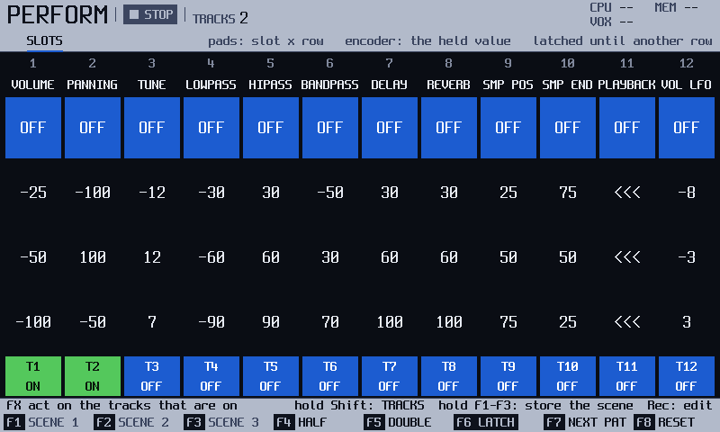
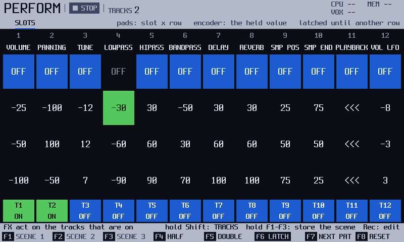
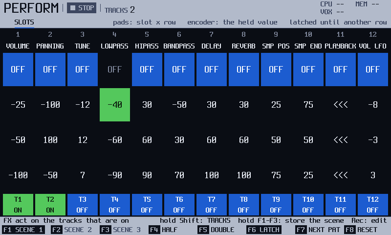
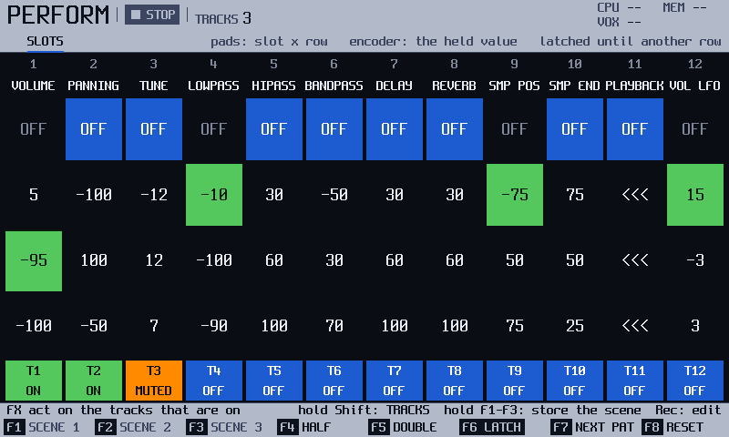

<!-- manual-sync: 571f81aa -->
# Perform
<!-- sync: src=seq/include/o3os/seq/perform.h,app/src/screens/perform_screen.cpp qa=QA-PRF-001,QA-PRF-002,QA-PRF-003 -->

Status: draft

Perform works on the whole pattern at once and live: nothing you do here is written into the steps. Twelve slots each hold one effect, and a pad press punches it in on the tracks you chose. You choose the tracks by holding `Shift` and using the top row of pads, not with screen keys. Three scenes, **HALF** and **DOUBLE** time, **NEXT PAT**, a pattern of its own for single tracks and **RESET** are new in track3r-os, and so is switching **LATCH** off. `Perform` pressed again opens the DJ page, which has [its own chapter](perform_dj.md). <!-- og: map 6.7 --> <!-- og: new -->

## What it is for

Use Perform to change how the pattern sounds while it plays, with your hands, and to put it back by letting go. Press `Perform` to open it. Perform opens on the page you left it on: **SLOTS** the first time, or the [DJ page](perform_dj.md) if you left it there. Press `Perform` again to turn to the other page.

## How it works
<!-- sync: src=seq/include/o3os/seq/perform.h,seq/src/perform.cpp,app/src/perform_actions.cpp spec=docs/specs/OS-PERFFX.md qa=QA-PRF-002,QA-PRF-003,QA-PRF-010,QA-PRF-011,QA-PRF-016,QA-PRF-025,QA-PRF-031 -->

### Live, not written

A Perform effect is a hand on the mixing desk, not a note in the pattern. The pattern keeps playing exactly as it was written, and the effect changes how it sounds while you hold it. An export never carries an effect. <!-- QA-PRF-010 -->

- **Live:** which effects are acting now, the value you turn in with the encoder while a pad is down, and which tracks are on.
- **Stored with the project:** each slot's effect, its chosen row and its three values, the three scenes, and the **LATCH** switch. <!-- QA-PRF-018 --> <!-- docs/formats/o3-project.md: SCEN holds the scenes and LATCH -->
- **Ends:** `F8` (**RESET**), the top pad of a slot, or leaving the screen for any screen except the Mixer (`Master`) and Song. Leaving also switches every track off. The chosen rows stay, so a latched value acts again as soon as you switch a track back on. `Play` and `Stop` do not end an effect. <!-- QA-PRF-011 -->

Example: hold a low-pass pad over a drum loop. The notes in the pattern do not change, and when you let go the loop sounds as it did.

### Pads: a slot for each column, a row for each value

The 48 pads are a grid of four rows by twelve columns. Each column is one slot, and the slot holds one effect, named above it. Count the pads from 1, left to right, top row first. Pad 4 is slot 4 on the top row, and pad 16 is slot 4 on the second row. <!-- seq/include/o3os/seq/perform.h: pad n is slot n % 12 on row n / 12, counted from 0 -->

The top row is **OFF**. The three rows below each keep a value. A new project starts them with three useful values for each effect, from mild to strong: **LOWPASS**, for example, has -30, -60 and -90, and **STUTTER** has 1/4, 1/8 and 1/16. A project you saved keeps its own values, 0 included. <!-- QA-PRF-145 --> <!-- QA-PRF-146 --> The screen draws 0 as `---`, except for three effects that name their values: **PLAYBACK** draws it `>>>`, **STUTTER** draws **OFF** and **PLAYMODE** draws **FWD**. Press a pad and its row becomes the slot's chosen row, and the value goes to the tracks that are on. Turn the encoder while you hold the pad to change the value of the held slots.

Example: pad 4 is **LOWPASS** on its top row. Press it and the filter ends. Press pad 16 and turn the encoder left, and the filter closes while you hold. A negative value closes a low-pass filter and a positive one opens it. Not checked against the original firmware. <!-- og: open -->

### Hold or latch

Turn the encoder and let go, and what happens depends on whether a value is stored. A value turned on its own is live: it lasts while the pad is down, and the pad's own stored value comes back when you let go (a stored 0 ends the effect). To keep a value, press `Rec` first. **EDIT** appears in the strip, and now the encoder stores the value in the row. <!-- QA-PRF-025 -->

With **LATCH** on (the default), a row that holds a value stays on after you let go, until you press another row of its slot or the top pad. With LATCH off (`F6`), the effect ends at the release, stored value or not. The switch is saved with the project.

Example: store -40 in pad 16, with LATCH on. A tap on it keeps the filter closed with both hands free. A tap on pad 4 opens it. LATCH off is new in track3r-os, and so is the rule that a value turned in live ends at the release. Whether a live value should outlive the pad with LATCH on is an open question. <!-- og: new --> <!-- og: open --> <!-- QA-PRF-025 -->

### Which tracks are affected

The boxes at the bottom, **T1** to **T12**, show **ON**, **OFF** or **MUTED**, or the number of the pattern a track plays when you have given it another one (see [Give single tracks another pattern](#give-single-tracks-another-pattern)). An effect acts only on the tracks that are **ON**. Hold `Shift` and the pads become the TRACKS layer: the top row switches each track on or off, row 2 mutes, row 3 sets the mute mode, and row 4 solos. A track that you switch on gets every effect that is on, latched ones included, at once, and one you switch off gets them all ended. Which tracks are on is not saved, and leaving Perform for most screens switches them all off. Different from the official manual, which uses screen keys. <!-- og: map 6.7 -->

Example: switch on T1 and T2, your drums. A low-pass now closes the drums and leaves the bass open.

### Which effects act

Up and Down in EDIT choose a slot's effect from a list of 21. All of them act. The three filters (**LOWPASS**, **HIPASS**, **BANDPASS**) block each other. Each effect has its own range. <!-- QA-PRF-004 --> <!-- QA-PRF-015 --> <!-- QA-PRF-012 --> <!-- QA-PRF-013 --> <!-- QA-PRF-020 --> <!-- QA-PRF-021 --> <!-- QA-PRF-026 --> <!-- QA-PRF-027 --> <!-- QA-PRF-151 --> <!-- QA-PRF-160 --> <!-- QA-PRF-161 -->

| Effect | What it does |
|---|---|
| **VOLUME** | cuts the tracks, down to silence at -100. It never boosts. |
| **PANNING** | moves the tracks left or right of their own pan. |
| **TUNE** | moves the pitch from -48 to +48 semitones. Sampler instruments only. |
| **SMP POS**, **SMP END** | start the next notes later in the sample and stop them earlier, as a share of the sample (or of the slice the note names). A positive value counts from the start, a negative one from the end: SMP POS +25 starts a quarter in, -25 plays only the last quarter; SMP END +75 stops at three quarters, -25 cuts off the last quarter. A note that sounds is not moved. A looped sample starts inside its first pass and ignores SMP END. Sampler instruments only: granular and wavetable instruments ignore both. |
| **PLAYBACK** | `<<<` plays the next notes backward, from the last frame to the first, and stops there; `>>>` (0) is the normal direction. It works on one-shot samples and on a beat slice (within the slice), and with **SMP POS** and **SMP END** it plays that part backward. A looped sample, a granular or wavetable instrument, the Amiga engine and module instruments ignore it. A note that sounds is not turned round; the next one is. The step effect Reverse (26) with 1 does the same, and a Reverse that is held when you press `Stop` stays on its track until the next fresh `Play`, as the other held step effects do, so pad notes you play after `Stop` are still backward. New Community OS behaviour. <!-- QA-PRF-153 --> <!-- QA-PRF-154 --> |
| **LOWPASS**, **HIPASS**, **BANDPASS** | the three filters. |
| **VOL LFO**, **PAN LFO**, **TUNE LFO**, **FLT LFO**, **POS LFO** | change how fast the track's LFO runs for the volume (tremolo), the pan (auto-pan), the pitch (vibrato), the filter cutoff and the wavetable window or granular position. The value moves the speed up (+) or down (-) the instrument's speed list, from -23 to +23 for VOL LFO and -28 to +28 for the others. If the instrument already has an LFO there, its shape and amount stay and only the speed moves. If it does not (that target is Off or an envelope), the effect runs an LFO for the track at 1 step plus the value, with the shape and amount stored on the instrument's LFO rows (a new instrument: triangle, 50 %; a stored amount under 5 %, as older projects and imported instruments often have, runs as a triangle at 50 %); at 50 % VOL LFO swings the volume between silence and half, a peak of -6 dB, so raise the amount for more. FLT LFO needs a filter that is on (the instrument's own, or a held LOWPASS, HIPASS or BANDPASS), POS LFO only moves wavetable and granular instruments. The LFOs follow the tempo and keep running when the song is stopped. A step with the Filter LFO FX (35) on the same track gives way to FLT LFO while it is held. Sampler instruments only. |
| **DELAY**, **REVERB** | open or close the track's send, -100 to +100. |
| **STUTTER**, **PLAYMODE**, **PAT LEN** | repeat steps, play forward, back, ping-pong or random, and force a pattern length. |
| **BITDEPTH**, **OVERDRV** | crush or distort the notes. 0 is clean. |

A new slot of the five LFO speeds reads -8, -3 and +3: slow, medium and fast. The way **VOLUME**, **PANNING**, **TUNE**, the five LFO speeds, **DELAY**, **REVERB**, **PLAYBACK**, **BITDEPTH** and **OVERDRV** act, and the four names of **PLAYMODE**, are new in track3r-os. The names **STUTTER** and **PAT LEN** follow the official manual. Not checked against the original firmware: what the effects do there. <!-- og: open -->

### Scenes

A scene is a snapshot of the twelve slots: the effect, the chosen row and the three values of each. It does not keep the tracks that are on. `Shift` + `F1` to `F3` store scene 1 to 3, and `F1` to `F3` recall them. New in track3r-os. <!-- og: new -->

## Try it
<!-- sync: src=seq/include/o3os/seq/perform.h,app/src/screens/perform_screen.cpp qa=QA-PRF-002,QA-PRF-003,QA-PRF-025 -->

1. Press `Perform`. If the strip says **PAGE DJ**, press `Perform` once more. All 12 slots read **OFF** and no track is on.
2. Hold `Shift` and press pad 1 and pad 2. Release `Shift`. **T1** and **T2** read **ON**.

   

3. Hold pad 16. The cell reads -30, the first value of **LOWPASS**. Turn the encoder left until it reads -40. **LOWPASS** closes the filter on T1 and T2 while you hold.
4. Let go. The -40 was not stored, so the cell goes back to its own -30 and stays lit.

   

5. Press `Rec`. Hold pad 16, turn the encoder left until it reads -40 and let go. Press `Rec` again. The value is stored, so the cell stays lit and reads -40.

   

6. Hold `Shift` and press `F1` (**STORE 1**). The strip says **SCENE 1 STORED**.
7. Press `F8` (**RESET**): every slot goes back to **OFF**. Press `F1` (**SCENE 1**): **LOWPASS** is on at -40 again, and the key row marks **SCENE 1**.

   

Not yet checked on the unit. <!-- QA-PRF-002 --> <!-- QA-PRF-003 --> <!-- QA-PRF-025 -->

## The screen at a glance
<!-- sync: src=app/src/screens/perform_screen.cpp -->

| Area | What it shows |
|---|---|
| Status line | **PERFORM**, the transport, **TRACKS** with the number of tracks that are on, and **EDIT** while EDIT is on. |
| Header | The caption **SLOTS** and a hint: whether LATCH keeps the row after you let go. |
| Main area | 12 slot columns: the slot's number, its effect, and four cells, **OFF** and three values. Under them, the boxes **T1** to **T12**. A box shows **ON**, **OFF** or **MUTED**; a track on another pattern shows that pattern (**07**), and one that waits to change shows **>07**, blinking. |
| Info line | In EDIT it names the slot. With no track on it tells you to hold `Shift` and use the top row of pads. |
| Key row | `F1` to `F3` are the scenes (dim while empty). `F4` to `F8` are in the keys table below. |
| Marks under the keys | The scene in force, the rate you hold, LATCH on, and NEXT PAT while it waits. |
| Shift row | **STORE 1**, **STORE 2**, **STORE 3**, then **PICK -**, **PICK +**, **TRK PAT**, **TRK NEXT** and **TRK SONG**. |

## More tasks

### Store a scene

Start on the Perform screen, with slots set the way you like.

1. Hold `Shift`. Press `F1` (**STORE 1**), `F2` or `F3`. <!-- QA-PRF-002 -->
2. Release both keys. The release recalls nothing.

You should see **SCENE 1 STORED** in the strip. A store replaces what the scene held, and Perform has no undo. Holding the plain key for about one second stores too. Scenes are saved with the project.

### Recall a scene

Start on the Perform screen, with a scene stored.

1. Tap `F1` (**SCENE 1**), `F2` or `F3`. <!-- QA-PRF-003 -->

You should see the scene's mark under its key. On an empty scene the strip says **SCENE IS EMPTY: HOLD THE KEY TO STORE**.

### Change the effect of a slot

Start on the Perform screen.

1. Press `Rec`. **EDIT** appears in the strip.
2. Press `Left` or `Right` to pick the slot. The info line names it.
3. Press `Up` or `Down` to change its effect. The list wraps, and the slot's three rows get the new effect's starting values. <!-- QA-PRF-145 -->
4. Press `Rec` to leave EDIT.

Use `Shift` + `Left` or `Right` to swap the slot with its neighbor. `Copy` copies the slot and `Shift` + `Copy` pastes it onto the picked slot.

### Play at half or double time

Start on the Perform screen with the pattern playing.

1. Hold `F4` (**HALF**) for half speed, or `F5` (**DOUBLE**) for double.
2. Hold `F4` and `F5` together for the song's own speed.

The mark under the key shows the rate. When you let go the pattern is back at its own speed.

### Queue the next pattern

Start on the Perform screen with the song playing.

1. Press `F7` (**NEXT PAT**). The pattern after this one in the song order starts when the pattern now playing ends.
2. Press `F7` again while it waits to cancel.

At the last pattern it goes back to the first. If it cannot queue, the strip says **NOT PLAYING**, **SONG IS EMPTY** or **PATTERN IS NOT IN THE SONG**.

### Give single tracks another pattern
<!-- sync: src=app/src/perform_actions.cpp,seq/include/o3os/seq/sequencer.h qa=QA-PRF-147,QA-PRF-148,QA-PRF-149 -->

Start on the Perform screen with the song playing and the tracks you want to change switched on (hold `Shift` and use the top row of pads).

1. Press `Shift` + `F7` (**TRK NEXT**) to send the tracks that are on to the next pattern of the song order. Or press `Shift` + `F4` or `F5` (**PICK -** or **PICK +**) until the strip shows the pattern you want, then press `Shift` + `F6` (**TRK PAT**).
2. Watch the track boxes. A box that waits shows **>07** and blinks. Each track changes at the end of its own loop, so tracks of different lengths change at different times.
3. Press `Shift` + `F8` (**TRK SONG**) to send the tracks that are on back to the pattern of the song.

A track that is off is not touched and shows **OFF**, not a pattern number. The same press again takes a waiting change back. Queueing the pattern a track already plays pins it at once, so it keeps that pattern when the song goes on. A track that has changed keeps its pattern when the song goes on, until you press **TRK SONG**, stop, or restart the transport (`Play` while it plays, or resume). A random track has no loop end, and a track longer than its pattern is restarted when the pattern ends. Both change at the end of the song's pattern. A pick that is no longer a pattern of the project says **PATTERN IS GONE: PICK ANOTHER** and queues nothing. Nothing is saved in the project. With the song stopped the strip says **NOT PLAYING**; with no track on, **NO TRACK IS ON: HOLD SHIFT + TOP PADS**.

New in track3r-os. Not yet checked on the unit; how the original firmware does it is an open research question. <!-- QA-PRF-147, QA-PRF-148, QA-PRF-149 -->

### Turn every effect off

1. Press `F8` (**RESET**). Every slot goes to **OFF**. The tracks that are on stay on.

## Keys on this screen
<!-- sync: src=app/src/perform_actions.cpp,app/src/bindings.cpp,seq/include/o3os/seq/perform.h qa=QA-PRF-003,QA-PRF-002,QA-PRF-001 -->

<!-- manual-tables: keys screen=perform -->
The key row, and the row drawn while `Shift` is held. `-` means the key does nothing.

| Key | Label | With `Shift` |
|---|---|---|
| `F1` | **SCENE 1** | **STORE 1** |
| `F2` | **SCENE 2** | **STORE 2** |
| `F3` | **SCENE 3** | **STORE 3** |
| `F4` | **HALF** | **PICK -** |
| `F5` | **DOUBLE** | **PICK +** |
| `F6` | **LATCH** | **TRK PAT** |
| `F7` | **NEXT PAT** | **TRK NEXT** |
| `F8` | **RESET** | **TRK SONG** |

<!-- /manual-tables -->

| Key | What it does | Ref |
|---|---|---|
| `Perform` | opens Perform; again, the DJ page | - |
| `F1` (**SCENE 1**), `F2`, `F3` | a tap recalls the scene; holding for about one second stores it | QA-PRF-003 |
| `Shift` + `F1` (**STORE 1**), `F2`, `F3` | stores the scene at once; the release recalls nothing | QA-PRF-002 |
| `Shift` + `F4` (**PICK -**), `F5` (**PICK +**) | pick the previous or next pattern of the project for **TRK PAT** | QA-PRF-147 |
| `Shift` + `F6` (**TRK PAT**) | queues the picked pattern on the tracks that are on, at each track's loop end; again cancels | QA-PRF-147, QA-PRF-001 |
| `Shift` + `F7` (**TRK NEXT**) | queues the next pattern of the song on the tracks that are on | QA-PRF-147 |
| `Shift` + `F8` (**TRK SONG**) | sends the tracks that are on back to the song's pattern | QA-PRF-147 |
| `F4` (**HALF**), `F5` (**DOUBLE**) | while held, half or double speed; together, the song's own speed | - |
| `F6` (**LATCH**) | switches LATCH | - |
| `F7` (**NEXT PAT**) | queues the next pattern; again cancels | - |
| `F8` (**RESET**) | every slot off; the tracks stay on | - |
| a pad | picks the pad's row on its slot and holds the slot | QA-PRF-025 |
| the encoder | changes the value of the held slots | QA-PRF-025 |
| hold `Shift` | the pads become the TRACKS layer | - |
| `Rec` | EDIT on or off | - |
| `Left`, `Right`, `Up`, `Down` (in EDIT) | pick a slot, change its effect | - |
| `Shift` + `Left`, `Right`; `Copy`, `Shift` + `Copy` (in EDIT) | swap, copy, paste a slot | - |

The DJ page has its own key row: `F1` **BANK -**, `F2` **BANK +**, `F3` **CURVE**, `F4` **FILTER**, `F5` **SCR**, `F6` **LATCH**, `F8` **RESET**, and nothing on `F7`. See [Perform: the DJ page](perform_dj.md).

## Good to know
<!-- sync: src=app/src/app.cpp qa=QA-PRF-001,QA-PRF-003,QA-PRF-031 -->

- A value you turn live ends when you let go. A row with a stored value (stored with `Rec` in EDIT) stays on after you let go while **LATCH** is on, which is the default. It ends when you press another row of the slot or the top-row pad, or `F8` (**RESET**). Not checked against the original firmware: an open research question. <!-- QA-PRF-023, QA-PRF-024 -->
- `F1` to `F3` recall a scene. Hold `F1` to `F3` for one second to store the current settings in it, or press `Shift` + `F1` to `F3` to store at once. `F4` is **HALF** time, `F5` is **DOUBLE** time, `F6` is **LATCH**, `F7` is **NEXT PAT** and `F8` is **RESET**. Choose the tracks with `Shift` and the top row of pads. The info line says so when no track is on. <!-- QA-PRF-002, QA-PRF-003, QA-PRF-006 -->
- While `Shift` is held, `F4` to `F8` are the per-track pattern keys (see above). They do not run the plain key under them. <!-- QA-PRF-001, QA-PRF-147 -->
- **TUNE** adds to the instrument's tune and fine tune, and a sounding note follows at once. Amiga-engine instruments and modules do not follow it. <!-- QA-PRF-031 -->
- An effect that is on stays on through `Play`, `Stop`, the Mixer and Song, and an export is the same with and without it. When a held **VOLUME** -100 or a closed send ends, the sound is back within a few milliseconds, with no click. <!-- QA-PRF-011 --> <!-- QA-PRF-016 --> <!-- QA-PRF-023 --> <!-- QA-PRF-024 --> <!-- QA-PRF-029 -->
- **PLAYMODE** **PING** bounces over the track: 0 1 2 3 2 1 0 on four steps, so the end steps play once per pass. A different pattern, a pattern switch or a jump starts it again, and so does resuming after a pause. Not yet checked on the unit. <!-- QA-PRF-004 -->
- A pad you hold while you go to the Mixer (`Master`) or Song is let go when you lift it there, so its value does not stay on. <!-- QA-PRF-143 -->
- A project that uses **BITDEPTH** or **OVERDRV** shows those two slots empty in an older build. <!-- QA-PRF-018 -->
- Not yet checked on the unit. Not checked against the original firmware, except where a line above says otherwise. <!-- og: open -->

> **Careful**: Leaving Perform for any screen except the Mixer (`Master`) or Song switches every track off, so every effect ends, with no message. The chosen rows stay.

> **Tip**: `F8` is **RESET** here, not undo.

## See also

- [Perform: the DJ page](perform_dj.md): crossfade two groups of tracks, filter, kill bands, scratch.
- [Mixer](mixer.md): levels and sends that the effects add to.
- [The panel](panel.md): where the keys are on the unit, and the Shift layer of the pads.

