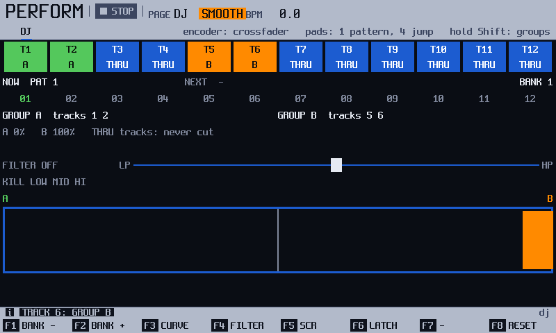
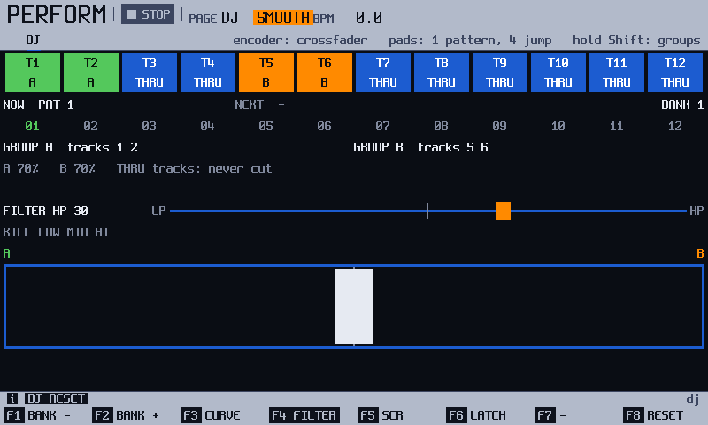
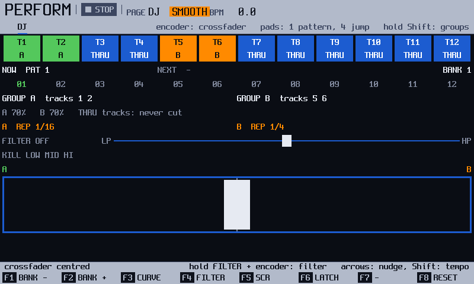
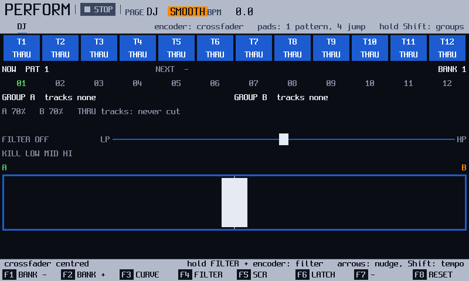

<!-- manual-sync: 67c2869a -->
# Perform: the DJ page
<!-- sync: src=app/src/dj_actions.cpp,app/include/o3os/app/dj.h,app/src/screens/perform_screen.cpp spec=docs/specs/OS-DJ.md qa=QA-PRF-100,QA-PRF-101,QA-PRF-104 -->

Status: draft

The DJ page turns the pattern that plays into something you mix by hand. You put some tracks in group A and some in group B, and a crossfader fades between the two groups, with a filter, band kills, stutters, a scratch and transitions to the next pattern. The page is new in track3r-os, and everything on it is live: nothing is written into the song or the project. <!-- og: new -->

## What it is for

Use the DJ page to play a set from one pattern after another: drums on A and a melody on B, a filter sweep into the next pattern, a stutter at the end of a bar. Press `Perform` to open [Perform](perform.md); it opens on the page you left it on, so the strip may already say **PAGE DJ**. If it shows the slots, press `Perform` again. Once more goes back to the slots.

## How it works
<!-- sync: src=app/src/dj_actions.cpp,app/include/o3os/app/dj.h,audio/src/graph.cpp spec=docs/specs/OS-DJ.md qa=QA-PRF-100,QA-PRF-104,QA-PRF-106,QA-PRF-114,QA-PRF-117,QA-PRF-127,QA-PRF-132,QA-PRF-138,QA-PRF-112,QA-PRF-126,QA-PRF-129,QA-PRF-133,QA-PRF-134,QA-PRF-135,QA-PRF-136,QA-PRF-142,QA-PRF-144,QA-PRF-150 -->

Everything on this page is **live** and ends when you leave it. Only the groups stay, until you switch the unit off. Nothing of the DJ page is saved in the project, and an export never carries it. New in track3r-os. Not yet checked on the unit. <!-- QA-PRF-106 --> <!-- QA-PRF-108 --> <!-- og: new -->

### Groups: who gets faded

A group is a set of tracks that the crossfader moves together. `Shift` + a pad of the top row sets the group of that pad's track: **THRU**, **A**, **B**, then **THRU** again. A track that is **THRU** is never touched. The screen names the groups, and the pad lights are off, dim and bright for THRU, A and B. Tracks 1 to 12 can be grouped. <!-- QA-PRF-104 -->

Example: drums (tracks 1 and 2) in A, the lead (track 5) in B. A bass on THRU plays through every fade.

### The crossfader and the curve

The crossfader is the bar at the bottom. The encoder moves it, and one turn is the whole way from **A** to **B**. With `Shift` held the steps are small. The bottom row of pads jumps it: pad 37 is all A, pads 38 to 41 are 10 to 40 %, pads 42 and 43 are both the centre, pads 44 to 47 are 60 to 90 %, and pad 48 is all B. The jump takes 20 milliseconds, which the encoder cannot do. The fader only cuts: it never makes a track louder, and it cuts the track's delay and reverb with it. <!-- QA-PRF-101 --> <!-- QA-PRF-102 --> <!-- QA-PRF-107 -->

`F3` (**CURVE**) picks how it cuts. **SMOOTH** fades with equal power, so both groups are 3 dB down at the centre. **CUT** keeps a group at full level until the last step, like a scratch fader. <!-- QA-PRF-103 -->

### Filter and kills: the whole mix

Hold `F4` (**FILTER**) and turn the encoder. Left closes a low-pass filter over the whole mix, right closes a high-pass filter, and the middle is off. When you let go the filter springs back. A tap on `F4` alone moves nothing and the strip says **FILTER: HOLD, TURN THE ENCODER**. Pad 28, **FILT**, does the same. <!-- QA-PRF-109 --> <!-- QA-PRF-110 --> <!-- QA-PRF-113 --> <!-- QA-PRF-142 -->

The pads **KILL LOW**, **MID** and **HI** (pads 25 to 27) cut one band while you hold them: below about 180 Hz, between 180 Hz and 2.8 kHz, above 2.8 kHz. The rest of the mix stays. <!-- QA-PRF-115 -->

**LATCH** (`F6`) changes the rule for all the holds: a filter stays where you left it, and a kill, **ECHO** or **CUT** pad stays on after a tap until you tap it again. A **REP** pad stays on until you tap another **REP** pad of its group. `F8` (**RESET**) ends them and the filter but keeps **LATCH**. <!-- QA-PRF-111 --> <!-- QA-PRF-112 --> <!-- QA-PRF-116 --> <!-- QA-PRF-126 --> <!-- QA-PRF-140 -->

### Pad effects: REP, ECHO and CUT

Row 2 acts on one group at a time. The six pads on the left are group **A** and the six on the right are group **B**, mirrored, so each hand has the same order from the outside in: **REP 1/4**, **REP 1/8**, **REP 1/16**, **REP 1/32**, **ECHO**, **CUT**. Hold a pad to use it. **REP** repeats the last note of each track of the group, as a stutter. It repeats notes, not audio. With two **REP** pads down in one group, the later one decides. **ECHO** opens the group's delay send, and one beat later cuts the group, so only the echoes ring out. **CUT** silences the group. ECHO needs the master delay level up, or the strip says **DELAY LEVEL IS 0**. <!-- QA-PRF-123 --> <!-- QA-PRF-124 --> <!-- QA-PRF-125 -->

### Pattern row, tempo and transitions

The top row of pads is the pattern row: the twelve patterns of a bank, with **NOW** and **NEXT** on the screen. A tap queues a pattern for the end of the one that plays, so no step is cut. `Left` or `Right` held nudges the tempo 4 % slower or faster and gives it back exactly at the release. <!-- QA-PRF-118 --> <!-- QA-PRF-119 --> <!-- QA-PRF-121 -->

A transition is an effect that ends on the switch to the next pattern. **TRANS HP** and **TRANS LP** (pads 29 and 30) close a filter slowly over the time left to the queued pattern, and the filter snaps open when it starts. **TRANS ECHO** (pad 31) sends the whole mix into the delay in the last beat. A sweep always lasts at least one bar. <!-- QA-PRF-129 --> <!-- QA-PRF-130 --> <!-- QA-PRF-131 -->

### Scratch and tape stop

`F5` (**SCR**) puts your hand on the record. The encoder becomes the platter, the mix goes quiet like a held record, and a full turn is 1.8 seconds of sound, and the encoder no longer moves the crossfader. The song keeps playing underneath, so when you tap `F5` again the mix is live at the place it has reached. Backwards it stops at the oldest sound kept, up to 4 seconds. Hold **TAPE STOP** (pad 32; with **SCR** on the strip says **SCRATCH IS ON**) and the whole mix slows to a stop over one beat; while you hold it, turn the encoder to make the stop shorter or longer, from 1/8 beat up to 4 beats (the screen shows the length, and the stop carries on from the speed it has; the next hold starts with the length you left). Let go and it is live again. Not yet checked on the unit: the platter, the backspin and the detents. <!-- QA-PRF-133 --> <!-- QA-PRF-134 --> <!-- QA-PRF-136 --> <!-- QA-PRF-144 -->

### What leaving the page ends

Pressing `Perform`, or any other screen button, ends every effect of this page at once with no click: the fader goes to the centre, **CURVE** to **SMOOTH**, **LATCH** off, and the filter, kills, pad effects, nudge, transition and scratch end. A queued pattern stays queued. <!-- QA-PRF-106 --> <!-- QA-PRF-114 --> <!-- QA-PRF-117 --> <!-- QA-PRF-127 --> <!-- QA-PRF-132 --> <!-- QA-PRF-138 -->

## Try it
<!-- sync: src=app/src/dj_actions.cpp,app/src/screens/perform_screen.cpp qa=QA-PRF-100,QA-PRF-102,QA-PRF-104,QA-PRF-105,QA-PRF-109,QA-PRF-110,QA-PRF-123 -->

1. Press `Perform`. If the strip does not say **PAGE DJ**, press `Perform` again. The strip says **PAGE DJ**, the twelve track boxes read **THRU**, and the fader is in the middle. <!-- QA-PRF-100 -->
2. Hold `Shift` and tap pads 1 and 2 once, and pads 5 and 6 twice. Release `Shift`. Tracks 1 and 2 are group **A**, tracks 5 and 6 are group **B**. <!-- QA-PRF-104 -->
3. Tap pad 48, the last pad of the bottom row. The fader jumps to the end of B, and the gains read `A 0%  B 100%`: group A is silent. <!-- QA-PRF-102 -->

   

4. Press `F8` (**RESET**). The fader goes back to the middle, and the groups stay. <!-- QA-PRF-105 -->
5. Hold `F4` (**FILTER**) and turn the encoder right three clicks. The filter row reads **FILTER HP 30**.

   

6. Let go of `F4`. The filter springs back and the row reads **FILTER OFF**. <!-- QA-PRF-110 -->
7. Hold pad 15 and pad 24. A line under the gains reads `A  REP 1/16` and `B  REP 1/4`. Let go and both end. <!-- QA-PRF-123 -->

   

With the pattern playing, you hear the filter close and open, and the stutters on tracks 1 and 2 and on tracks 5 and 6. Not yet checked on the unit.

## The screen at a glance
<!-- sync: src=app/src/screens/perform_screen.cpp qa=QA-PRF-100 -->

| Area | What it shows |
|---|---|
| Status line | **PERFORM**, the transport, **PAGE DJ**, the curve (**SMOOTH** or **CUT**) and the tempo. |
| Track boxes | **T1** to **T12** with their group: **THRU**, **A** or **B**. |
| Pattern row | **NOW**, **NEXT** and **BANK**, and the twelve pattern numbers of the bank. |
| Group lines | The tracks of each group, the gains of A and B, and a line for the pad effects in force. |
| Filter and kill rows | **FILTER** with its value and a bar from **LP** to **HP**; **KILL** with **LOW**, **MID** and **HI**. |
| Tape stop line | While **TAPE STOP** is held, its length above the crossfader (`TAPE STOP 1 BEAT`). |
| Crossfader | The bar from **A** to **B** with its knob. |
| Key row | **BANK -**, **BANK +**, **CURVE**, **FILTER**, **SCR**, **LATCH**, blank, **RESET**. The Shift row is blank. <!-- QA-PRF-141 --> |

## More tasks

### Fade between two groups with a hard edge

Start on the DJ page, with tracks in A and B.

1. Press `F3` (**CURVE**). The chip in the strip reads **CUT**. <!-- QA-PRF-103 -->
2. Turn the encoder from A to B. A group stays at full level until the last step of the fader.

Press `F3` again for **SMOOTH**.

### Cut a band and keep it

Start on the DJ page.

1. Press `F6` (**LATCH**). The strip says **LATCH ON: FILTER AND PAD EFFECTS STAY**. <!-- QA-PRF-140 -->
2. Tap pad 26 (**KILL MID**). The **KILL** row keeps **MID** lit and reads **LATCHED**. <!-- QA-PRF-116 -->
3. Tap pad 26 again to bring the band back.

Both hands are free for the fader and the filter. `F8` (**RESET**) ends every kill and filter and keeps **LATCH**.

### Queue a pattern from another bank

Start on the DJ page with the song playing.

1. Press `F2` (**BANK +**). The pattern row moves up one bank. If the pattern that plays is in bank 1, the screen reads **BANK 2** and shows patterns 13 to 24. <!-- QA-PRF-120 -->
2. Tap a pad of the top row. The pad blinks and **NEXT** names the pattern. <!-- QA-PRF-119 -->
3. Tap the blinking pad again to cancel.

Stopped, a tap picks the pattern to edit, as the pads on Pattern do.

### Nudge the tempo

Start on the DJ page with the pattern playing.

1. Hold `Right`. The strip shows **NUDGE +4%** and the new tempo. Stopped, it says **NUDGE NEEDS PLAY**. <!-- QA-PRF-121 -->
2. Let go. The tempo is exactly what it was.

`Shift` + `Left` or `Right` changes the song's tempo by 0.1 BPM and keeps it in the project, between 40 and 800 BPM. <!-- QA-PRF-122 --> With the clock set to MIDI slave, both leave the tempo alone and the strip says **MIDI SLAVE: THE CLOCK SETS THE TEMPO**.

### Leave with a transition

Start on the DJ page, playing.

1. Tap a pad of the top row to queue the next pattern, or leave it. With nothing queued, the song's next slot is queued for you, so you need a song that holds the pattern that plays. Without one the strip says **SONG IS EMPTY** or **PATTERN IS NOT IN THE SONG**, and nothing starts.
2. Tap pad 29 (**TRANS HP**) or pad 30 (**TRANS LP**). The **NEXT** line reads `TRANS HP 8 %` and counts up. Stopped or in the count-in, the strip says **TRANS NEEDS PLAY** or **TRANS NEEDS THE COUNT-IN OVER**. <!-- QA-PRF-129 -->
3. Wait. When the pattern ends the new one starts and the filter opens at once.

Tap the same pad again to cancel. The queued pattern stays queued. If less than a bar is left, the pattern plays once more first. <!-- QA-PRF-130 -->

### Scratch and spin back

Start on the DJ page, playing, with no loop recording.

1. Tap `F5` (**SCR**). The strip says **SCR ON: THE ENCODER IS THE PLATTER**. <!-- QA-PRF-133 -->
2. Turn the encoder. The mix moves with it, and a turn back plays the mix backwards. The platter has a little weight, about a fortieth of a second: a very slow turn is a smooth glide, and a stop or a start is a short curve, never a click or a step. A quick forth-and-back scratch returns to the same place, within about one click, and a turn back after a hard flick follows the new direction at once. <!-- QA-PRF-150 -->
3. To backspin, flick the platter fast backwards and tap `F5` while it still spins. The record brakes in about half a second and the mix is live. A slow turn, or a hand held still, lets go at once. <!-- QA-PRF-135 --> <!-- QA-PRF-150 -->

If the looper is recording, the strip says **NO ROOM: LOOPER IS RECORDING**; without free sample memory it says **NO ROOM FOR THE SCRATCH**. <!-- QA-PRF-137 --> <!-- QA-PRF-133 --> Until the scratch ends, opening a project says **END THE SCRATCH FIRST**. <!-- QA-PRF-139 -->

## Keys on this screen
<!-- sync: src=app/src/dj_actions.cpp,app/src/bindings.cpp qa=QA-PRF-100,QA-PRF-103,QA-PRF-109,QA-PRF-133 -->

| Key | What it does | Ref |
|---|---|---|
| `F1` (**BANK -**), `F2` (**BANK +**) | the pattern row moves one bank of twelve | QA-PRF-120 |
| `F3` (**CURVE**) | **SMOOTH** or **CUT** | QA-PRF-103 |
| hold `F4` (**FILTER**) + the encoder | the filter; it springs back at the release | QA-PRF-109 |
| `F5` (**SCR**) | the encoder becomes the platter | QA-PRF-133 |
| hold **TAPE STOP** (pad 32) + the encoder | the length of the stop, 1/8 to 4 beats | QA-PRF-144 |
| `F6` (**LATCH**) | filter, kills and pad effects stay | QA-PRF-111 |
| `F8` (**RESET**) | fader to the centre, filter, kills, pad effects and transition off | QA-PRF-105 |
| the encoder; `Shift` + the encoder | the crossfader; small steps | QA-PRF-101 |
| `Shift` + a top-row pad | sets the group of that track | QA-PRF-104 |
| row 1 pad | queues that pattern | QA-PRF-119 |
| row 2 pads | **REP**, **ECHO**, **CUT** of group A and B | QA-PRF-123 |
| row 3 pads 25 to 32 | **KILL LOW**, **MID**, **HI**, **FILT**, **TRANS HP**, **TRANS LP**, **TRANS ECHO**, **TAPE STOP** | QA-PRF-115 |
| row 4 pad | jumps the fader, pad 37 all A, 42 and 43 the centre, pad 48 all B | QA-PRF-102 |
| hold `Left` or `Right`; `Shift` + `Left` or `Right` | nudge the tempo; change it by 0.1 BPM | QA-PRF-121 |

## Good to know
<!-- sync: src=app/src/dj_actions.cpp qa=QA-PRF-107,QA-PRF-115,QA-PRF-128,QA-PRF-141 -->

- A kill takes the middle of its band down by 40 dB or more and falls away at 24 dB an octave. At the very edge it is only 6 dB down, so the band does not end like a wall. <!-- QA-PRF-115 -->
- The effects of row 2 are the Perform effects **STUTTER**, **DELAY** and **VOLUME**, put above the slots while the page is in view. A slot's own effect comes back when the pad ends. <!-- QA-PRF-127 -->
- `Shift` + `F1` to `F8` do nothing here and show no label. <!-- QA-PRF-141 -->
- Pads 33 to 36 of row 3 do nothing. A held pad that you let go of after the page changed does no harm.
- New in track3r-os. Not yet checked on the unit: the filter, the kills, the transitions, the scratch and tape stop. Not checked against the original firmware.

## See also

- [Perform](perform.md): the slots, the scenes and the Shift layer of the pads.
- [Record](record.md): the looper, which the scratch cannot run beside.
- [Mixer](mixer.md): the delay and reverb levels that ECHO uses.
