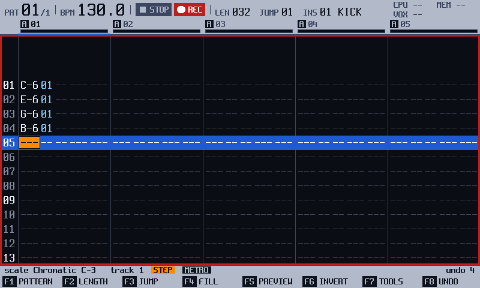
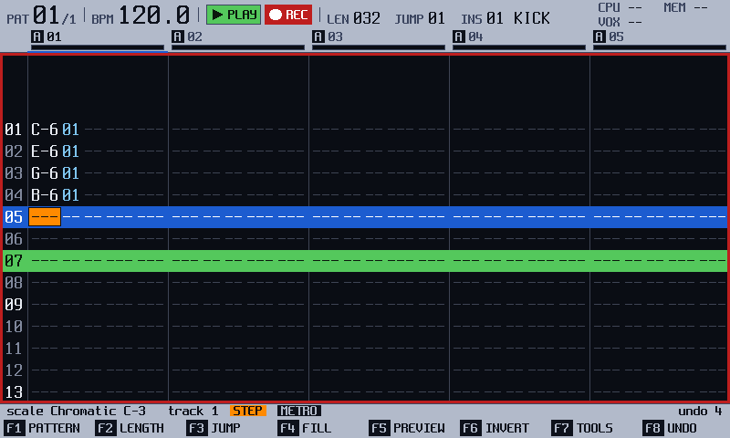

<!-- manual-sync: 48ab84b9 -->
<!--
Chapter: Quick start. Rules: .claude/skills/manual-writing/SKILL.md, section 11. Only facts that the chapters linked from each line already give.
Sources: docs/qa/catalogue/global.md (QA-GLB-015, 102, 118), record.md (QA-REC-020 to 023, 028), modules.md (QA-MOD-002), pattern.md (QA-PAT-001, 006, 126, 254), sample_load.md, file.md (QA-FIL-070 to 072), usb_disk.md (QA-CFG-200), getting_started.md (the first start and the demo kit), mixer.md (QA-MIX-030).
Open rows, not written: none.
-->
# Quick start

Status: draft

This page is for owners who know the official firmware, and it shows what is different in track3r-os in about five minutes. If you are new to trackers, go to [New to trackers?](#new-to-trackers) below.

## Installing

Follow [Installing track3r-os](install.md), and read [Getting started](getting_started.md) once before you do. Back up the card first.

## What's different
<!-- sync: src=app/src/bindings.cpp qa=QA-REC-020,QA-REC-021,QA-REC-022,QA-REC-023,QA-REC-028,QA-MOD-002,QA-GLB-015,QA-CFG-200,QA-GLB-102,QA-GLB-109,QA-PAT-254,QA-PRF-001,QA-MIX-030,QA-GLB-118,QA-GLB-141,QA-GLB-130 -->

Items 1, 2 and 4 are features that are new in track3r-os. <!-- og: new --> The others exist on the official unit too, and each says what is different.

1. **A looper.** On the Record screen (`Sample Rec`) you can record a loop of 1 to 16 bars that plays in time with the pattern, and add layers on top. New in track3r-os. See [Record](record.md). <!-- QA-REC-020, QA-REC-021, QA-REC-022, QA-REC-023, QA-REC-028 -->
2. **Modules.** A `.tmod` file on the card adds a sound engine, such as a TB-303, to the instrument types, or an app you start from the Modules screen. New in track3r-os. See [Modules](modules.md). <!-- QA-MOD-002 -->
3. **Step effects.** Every step has two effect cells, **FX1** and **FX2**, in the **Fx** column, as on the official unit: a chord, an arpeggio, a slide, a drive, a volume change. Only effect types 46 to 62, the tracker effects, are new in track3r-os. See [Effects in the pattern](fx.md). <!-- og: new -->
4. **The card as a disk.** Hold `Shift`, `F1` and `F7` while you turn the unit on, and the card shows on your computer as a disk. In `Config`, the **CARD AS DISK** row shares the card while the unit keeps playing, and the computer can only read it unless you turn **READ ONLY** off first. New in track3r-os. See [USB disk](usb_disk.md#use-the-card-on-a-computer-at-power-on). <!-- QA-GLB-015, QA-CFG-200 -->
5. **Power off.** As on the official unit, you hold the `Power` button on the rear panel. Here a line across the top fills over 2 seconds, and a press wakes the unit. Power off never saves the project: the strip warns **UNSAVED WORK** while you hold, so press `F4` (**SAVE**) first. The official firmware autosaves, and track3r-os saves nothing by itself. See [Getting started](getting_started.md#turn-the-unit-off). <!-- QA-GLB-102, QA-GLB-109, og: different -->
6. **Pattern.** The official unit has `Rec` for editing, live recording and an instant pattern switch. Here `Rec` turns step entry on, `Shift` + `Rec` turns live recording on, and holding `F1` while a pattern plays switches to another pattern at the next step, with no stop. See [Pattern](pattern.md). <!-- QA-PAT-254, og: different -->
7. **Perform.** The `Perform` button opens 12 effect slots you play with the pads, live and not written into the steps, with three scenes to store a setup. The scenes are new in track3r-os. Not checked against the original firmware: the rest of the screen. See [Perform](perform.md). <!-- QA-PRF-001 -->
8. **Keys.** As on the official unit, hold `Master` and turn the encoder to set the master volume on any screen. The official unit also sets the tempo from any screen. Here, hold `Pattern` and turn the encoder, or tap pads while you hold it (new in track3r-os), and the Song screen has the tempo field (`F7`). New in track3r-os: hold `Shift` and press `Pattern` for the Navigator, a list of every screen, and press `Vol` and `Fx` together for MIDI Learn. Also new: `Shift` + `Config` opens a help page for the screen you are on, and `Shift` + `Power` saves a screenshot to the card. See [The panel](panel.md) and [Mixer](mixer.md). <!-- QA-MIX-030, QA-MOD-002, QA-GLB-118, QA-GLB-153, QA-GLB-141, QA-GLB-130 -->

## New to trackers?
<!-- sync: src=app/src/bindings.cpp,app/src/save_service.cpp qa=QA-FIL-070,QA-FIL-071,QA-PAT-001,QA-PAT-006,QA-PAT-126,QA-FIL-072 -->

A tracker writes music as a grid. Each row is a **step**, and each column group is a **track**. The unit plays the rows from top to bottom, and a **pattern** is one such grid. A **project** is everything you save: patterns, song order, instruments and their samples. An **instrument** is a slot that makes sound from a sample. These words are in the [glossary](glossary.md).

1. Turn the unit on. After the logo, a card with no project starts the demo kit: four instruments and pattern 1, which already holds a two-bar beat. Press `Play` to hear it, and `Play` again to stop. <!-- QA-PAT-126 -->
2. To start from an empty pattern, press `File`, then `F3` (**NEW**), then `F1` (**KEEP INS**). You keep the four instruments, and the Pattern screen opens on an empty pattern in **WATCH**, where a pad only previews the sound of the instrument in the header. Press a pad to hear it. <!-- QA-FIL-070, QA-FIL-071, QA-PAT-001 -->
3. Press `Rec`, then four pads. The chip reads **STEP**, and each pad writes a note on the cursor's step and moves the cursor on. <!-- QA-PAT-006 -->

   

4. Press `Play`. The pattern loops, and you hear your four notes with the sound of instrument 1 at the start of every pass, then a gap until the pattern ends. Press `Play` again to stop.

   

5. Press `File`, then `F4` (**SAVE**). The strip says **SAVE TRACK 01 DONE**: a project with no folder yet is saved in the first free folder named Track and a number, titled or not. <!-- QA-FIL-072 -->

To bring in your own sound, see [Sample load](sample_load.md). To write more, see [Pattern](pattern.md).

## Where next

- [Pattern](pattern.md): the record modes, copy and paste, and the pattern switch.
- [Perform](perform.md): effects you play live.
- [Record](record.md): sampling and the looper.
- [Modules](modules.md): sound engines and apps from the card.
- [Cheat sheet](cheat_sheet.md): the keys on one page.
