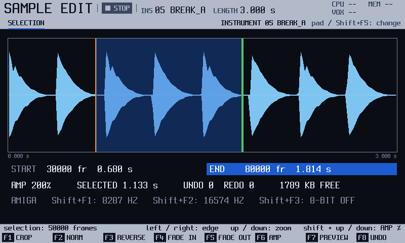
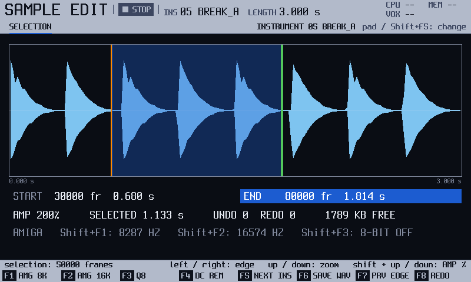

<!-- manual-sync: 571f81a -->
# Sample edit
<!-- sync: src=app/src/bindings.cpp,app/src/sample_edit_actions.cpp,app/src/save_actions.cpp,app/src/screens/sample_edit_screen.cpp,app/include/o3os/app/screens/sample_edit_screen.h qa=QA-SED-001,QA-SED-002,QA-SED-003,QA-SED-004,QA-SED-019,QA-SED-020,QA-SED-021 -->

Status: draft

Sample edit changes the sample itself: crop, normalize, reverse, the fades and the volume. Each process is one undo step. It differs from the original firmware's editor in three small ways. **NORM** always takes the loudest point to full scale, and has no level setting. **AMP** sets the volume as a percentage, from 10 to 800. A pad picks the instrument (so does `Shift` + `F5`, the next one, and holding `Instrument` opens the list of sample instruments), and `F7` (**PREVIEW**) plays it. New in track3r-os, on the Shift row: the Amiga conversion with its 8-bit option (`Shift` + `F1`, `F2` and `F3`), DC removal (`Shift` + `F4`), **NEXT INS** (`Shift` + `F5`) and **SAVE WAV** (`Shift` + `F6`), and a second page, **FX**, with a **FILTER** and a **COMPRESSOR** (press `Sample Edit` again). <!-- map 6.3: Normalizer, Amplifier, Preview with the pads: different; DC, Amiga, 8-bit, SAVE WAV: new -->

There is no preview before an edit is applied: an edit applies at once. Each edit is one undo step, and three steps are kept. To compare, apply the edit, hold `F7` (**PREVIEW**) to listen, and take the edit back with `F8` (**UNDO**). <!-- E-EDIT-04 (audit row 16): whether the original firmware previews an edit before applying it is an open research question; this way of comparing is new Community OS behaviour -->

## What it is for

Use Sample edit to change a loaded sample: crop, normalize, reverse, fade, change its volume, remove its DC offset, filter it, compress it or convert it to an Amiga rate. Open it with the `Sample Edit` button. A process acts on the selection, or on all of the sample when nothing is selected. `F8` takes it back, up to three steps. <!-- TODO: ask: the printed label of the Sample Edit button (code: no answer) -->

## The screen at a glance

| Area | What it shows |
|---|---|
| Header | **SELECTION**, and at the right the instrument you are editing (**INSTRUMENT 05 BREAK_A**) with the reminder `pad / Shift+F5: change`. |
| Main area | The sample, the selection, the **AMP** percentage, the length selected, the undo and redo steps left and how much sample memory is free (for example **4908 KB FREE**, rounded down: the same sample memory as the Sample load card and Config show; new in the Community OS). An effect needs a work buffer as big as the sample. When no buffer set aside earlier is free and big enough, the effect sets a new one aside (at most four), and the figure drops by that much, also when you cancel the effect; a cancelled effect's buffer is used again by the next effect. The buffers are given back when a project loads, on New project with **ALL** and at power-on; New project with **KEEP INSTRUMENTS** keeps them. <!-- QA-SED-018 --> |
| Info line | The selection in frames, or "no selection". |
| Strip | Messages, for example **EDIT DC REMOVE** or **NOTHING TO NORMALISE**. |
| Key row and Shift row | See "Keys on this screen". |

## More tasks

### Select a part
<!-- sync: src=app/src/sample_edit_actions.cpp -->

Start on Sample edit. With no selection, a process acts on all of the sample.

1. Turn the encoder. A selection appears and the encoder moves its start edge.
2. Press `Right` for the end edge, `Left` for the start, and turn the encoder. `Shift` + the encoder moves 16 times as far. `Up` and `Down` zoom.

You should see the selection in frames on the info line. `Delete` clears it.

### Normalize and take it back
<!-- sync: src=app/src/sample_edit_actions.cpp qa=QA-SED-002,QA-SED-004 -->

1. Press `F2` (**NORM**). The loudest point of the range goes to full scale. <!-- QA-SED-002 -->
2. Press `F8` (**UNDO**) to get the sample back exactly. `Shift` + `F8` (**REDO**) does it again. <!-- QA-SED-004 -->

If the sample is already at full scale or silent, the strip says **NOTHING TO NORMALISE**.

### Crop, reverse, fade or change the volume
<!-- sync: src=app/src/sample_edit_actions.cpp qa=QA-SED-005,QA-SED-006,QA-SED-007,QA-SED-008,QA-SED-009,QA-SED-010,QA-SED-011,QA-SED-015 -->

1. Select the part. Press `F1` (**CROP**) to keep it. <!-- QA-SED-005 --> Press `F3` (**REVERSE**), `F4` (**FADE IN**) or `F5` (**FADE OUT**). <!-- QA-SED-006, QA-SED-007, QA-SED-008 --> The strip says, for example, **EDIT REVERSE DONE**.
2. Press `F6` (**AMP**) to multiply the range by the **AMP** percentage, which starts at 200 %. Loud peaks are clipped, not wrapped. <!-- QA-SED-009 -->
3. `Shift` + `Up` or `Down` sets **AMP**, from 10 to 800 in steps of 10. It only sets the factor for the next `F6`: the sample is not touched. <!-- QA-SED-011 -->
4. Hold `F7` (**PREVIEW**) to hear it. `Shift` + `F7` (**PRV EDGE**) plays from the edge. <!-- QA-SED-010, QA-SED-015 -->

**CROP** needs a selection that is smaller than the sample, or it refuses and makes no step. A crop moves the instrument's points and slices to the new length. Not yet checked on the unit.

### Remove the DC offset
<!-- sync: src=app/src/sample_edit_actions.cpp qa=QA-SED-003 -->

A DC offset means the sample sits above or below its centre line. Press `Shift` + `F4` (**DC REM**). <!-- QA-SED-003 --> The strip says **EDIT DC REMOVE** and **DONE**. A centred range says **NO DC OFFSET TO REMOVE**, and a full-scale one **NO ROOM: SAMPLE AT FULL SCALE** or **DC PARTLY REMOVED: FULL SCALE LIMIT**.

### Filter or compress
<!-- sync: src=app/src/sample_edit_actions.cpp,app/src/screens/sample_edit_screen.cpp qa=QA-SED-019,QA-SED-020,QA-SED-021,QA-SED-022,QA-SED-023 -->

New in track3r-os (the original firmware's editor has neither). Both act on the selection, or on all of the sample when nothing is selected, run as a job with a progress bar in the strip, and are one undo step each. A result that is too loud is clipped at the top, like **AMP**.

1. Make the selection on the edit page, then press `Sample Edit` again. This is the **FX** page. <!-- QA-SED-019 -->
2. Press `Up` or `Down` to pick a row and turn the encoder to change its value. `Shift` + the encoder changes it in bigger steps.
3. For the **FILTER**, set **TYPE** (low pass, high pass or band pass), **CUTOFF** in Hz and **RESONANCE** (the Q: 0.5 to 15). Press `F1` (**FILTER**). A low pass takes away what is above the cutoff, a high pass what is below. <!-- QA-SED-020 -->
4. For the **COMPRESSOR**, set **THRESHOLD** (dB), **RATIO**, **ATTACK** and **RELEASE** in ms, **MAKEUP** (**AUTO**, or 0 to 24 dB) and **DETECTOR** (**PEAK** or **RMS**). Press `F2` (**COMPRESS**). Above the threshold the level comes down by the ratio. **AUTO** makeup brings a full-scale peak back to full scale. <!-- QA-SED-021 -->
5. Press `F8` (**UNDO**) to take it back. Press `Sample Edit` again to return to the edit page.

A long process, such as the compressor on a sample of tens of seconds, can be stopped: while the strip shows its progress the key row reads **CANCEL** on `F8`. Press it and the strip says **EDIT COMPRESSOR CANCELLED**. The sample stays exactly as it was and nothing is added to the undo steps. When the process has ended, `F8` is **UNDO** again. <!-- QA-SED-023 -->

The filter starts from silence at the first frame of the selection, so a selection that starts in the middle of a loud sound may click at its start. The exception is a looping instrument whose processed range starts at its loop start (in practice a loop that starts at the first frame, with the whole sample or a selection from 0): the filter and the compressor first run over the end of the loop, so the loop wraps without a click. Edge handles do not snap to the loop markers. If the loop starts in the middle of the sample (a sustain loop) and you process the whole sample, a click can remain at the wrap; process from the loop start instead. <!-- QA-SED-022 --> A long sample takes a while, the compressor longer than the filter (the time is not yet measured on the unit). Both are not yet checked on the unit: listen to the result before you keep it. The values you set stay until you switch the unit off.

### Convert to an Amiga rate
<!-- sync: src=app/src/sample_edit_actions.cpp qa=QA-SED-001,QA-SED-012,QA-SED-013,QA-SLD-009 -->

1. Press `Shift` + `F1` (**AMG 8K**) for 8,287 Hz, or `Shift` + `F2` (**AMG 16K**) for 16,574 Hz. <!-- QA-SED-001 --> All of the sample is converted in one step, and the strip says **EDIT AMIGA 8287 DONE**. <!-- QA-SED-012 -->
2. `Shift` + `F3` (**Q8**) switches the 8-bit option on and off for the next conversion. The line under the sample and the strip say **8-BIT ON** or **OFF**. <!-- QA-SED-013 -->

The sample still plays at its original pitch. <!-- QA-SLD-009 --> Not yet checked on the unit.

## Keys on this screen

<!-- sync: src=app/src/save_actions.cpp,app/src/save_service.cpp qa=QA-SED-002,QA-SED-004,QA-SED-001,QA-SED-003 -->

<!-- manual-tables: keys screen=sample_edit -->
The key row, and the row drawn while `Shift` is held. `-` means the key does nothing.

| Key | Sample edit | FX page | With `Shift` |
|---|---|---|---|
| `F1` | **CROP** | **FILTER** | **AMG 8K** |
| `F2` | **NORM** | **COMPRESS** | **AMG 16K** |
| `F3` | **REVERSE** | - | **Q8** |
| `F4` | **FADE IN** | - | **DC REM** |
| `F5` | **FADE OUT** | - | **NEXT INS** |
| `F6` | **AMP** | - | **SAVE WAV** |
| `F7` | **PREVIEW** | **PREVIEW** | **PRV EDGE** |
| `F8` | **UNDO** | **UNDO** | **REDO** |

<!-- /manual-tables -->

| Key | What it does | Ref |
|---|---|---|
| `F1` (**CROP**) | Keep only the selection. | none yet |
| `F2` (**NORM**) | Normalise the selection, or the whole sample if there is none. | QA-SED-002 |
| `F3` (**REVERSE**), `F4` (**FADE IN**), `F5` (**FADE OUT**) | Reverse or fade the selection, or the whole sample. | none yet |
| `F6` (**AMP**) | Change the volume by the **AMP** percentage. `Shift` + `Up` and `Down` set it. | none yet |
| `F7` (**PREVIEW**) | Play the sample while held. | none yet |
| `Left`, `Right`, the encoder, `Delete` | Pick an edge, move it, clear the selection. | none yet |
| `F8` (**UNDO**, **CANCEL** while a process runs) | Take back the last process; while a process is running, stop it and leave the sample as it was. | QA-SED-004, QA-SED-023 |
| FX page: `F1` (**FILTER**), `F2` (**COMPRESS**) | Filter or compress the selection, or the whole sample. `Up`, `Down`, `Left`, `Right` pick a row, the encoder changes it. | QA-SED-019, QA-SED-020, QA-SED-021 |
| `Shift` + `F1` (**AMG 8K**) | Convert to the Amiga rate of 8,287 Hz. | QA-SED-001 |
| `Shift` + `F2` (**AMG 16K**) | Convert to the Amiga rate of 16,574 Hz. | QA-SED-001 |
| `Shift` + `F3` (**Q8**) | The 8-bit option of the Amiga conversion. | QA-SED-001 |
| `Shift` + `F4` (**DC REM**) | Remove the DC offset of the selection, or of the whole sample. | QA-SED-001, QA-SED-003 |
| `Shift` + `F5` (**NEXT INS**) | Edit the next instrument, 64 round to 1 (a slot that holds no sample says **NO SAMPLE IN THIS INSTRUMENT** to an effect). A pad picks one of 1 to 48 directly. | QA-SED-001, QA-SED-017 |
| `Shift` + `F6` (**SAVE WAV**) | Save the sample, as it is now, as a mono WAV file in the `Samples` folder of the card, named `SMP_001.wav`, `SMP_002.wav` and so on, at the instrument's rate. | QA-SED-001 |
| `Shift` + `F7` (**PRV EDGE**) | Preview from the edge of the selection. | QA-SED-001 |
| `Shift` + `F8` (**REDO**) | Do the process again after an undo. | QA-SED-001, QA-SED-004 |

## Good to know
<!-- sync: src=app/src/sample_edit_actions.cpp qa=QA-SED-002,QA-SED-003,QA-SED-004,QA-SED-014,QA-SLD-010 -->

- Each process is one undo step, up to three. <!-- QA-SED-004 -->
- `Left` and `Right` pick the start or the end of the selection. The encoder moves the picked edge one column of the view a click (one frame only at full zoom), and `Shift` + encoder moves it 16 columns at a time. `Delete` clears the selection. `Up` and `Down` zoom the view. <!-- QA-SED-016 -->
- `F7` (**PREVIEW**) plays the instrument while you hold it. `Shift` + `F7` (**PRV EDGE**) plays from the picked edge while you hold it. <!-- QA-SED-010, QA-SED-015 -->
- The Amiga conversion refuses a wavetable: **A WAVETABLE CANNOT BE CONVERTED**. A sample converted with **AMG 8K** reloads at 8,287 Hz on the Amiga engine. <!-- QA-SLD-010 -->
- **SAVE WAV** with no card write layer says **NO CARD WRITE LAYER**, and with no sample **NO SAMPLE IN THIS INSTRUMENT**. It writes nothing then. <!-- QA-SED-014 -->
- Not yet checked on the unit: the processes and the Amiga keys. Not checked against the original firmware: the keys on this screen. <!-- og: open -->

## See also

- [Sample load](sample_load.md): bring the sample into an instrument.
- [Wave and Chop](wave.md): the play mode and the slices.
