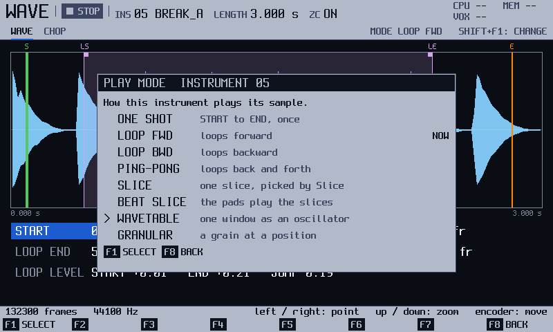
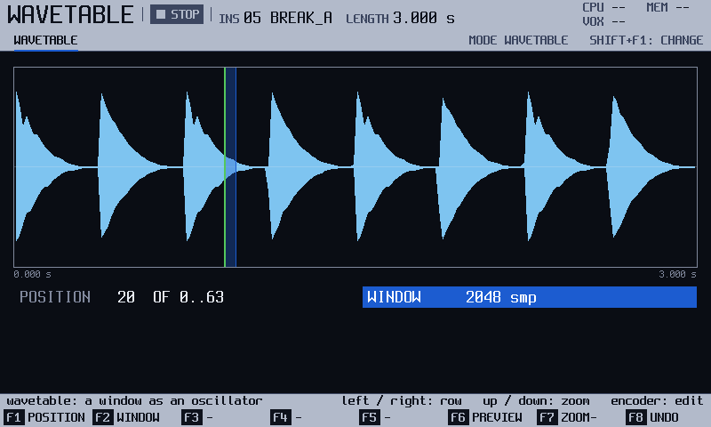
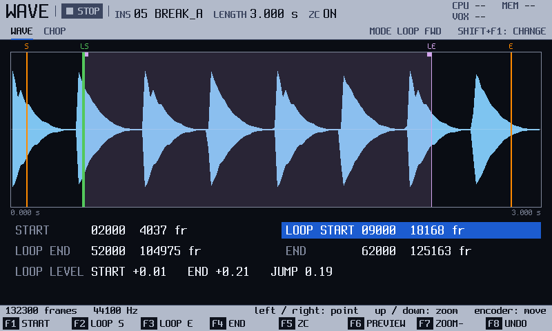

<!-- manual-sync: 571f81aa -->
# Wave and Chop
<!-- sync: src=app/src/bindings.cpp,app/src/wave_actions.cpp,app/src/screens/wave_screen.cpp,app/include/o3os/app/screens/wave_screen.h qa=QA-WAV-001,QA-WAV-003,QA-WAV-006 -->

Status: draft

The play mode of a sample is also set on this screen, as well as on the **PLAY MODE** row of Instrument. `Shift` + `F1` (**MODE**) opens a list of eight modes, and the mode decides the view: the slice modes open the CHOP page, and WAVETABLE and GRANULAR have views of their own. The WAVETABLE and GRANULAR views are described by the official manual, and their key labels were not compared with an official unit. <!-- og: QA-WAV-004, QA-WAV-005 (documented, label set open) -->

## What it is for

Use Wave to see how a sample plays: its mode and the part of it that sounds. Use CHOP to place the slices of a slice mode. Press `Sample Play` to open it. <!-- TODO: ask: the printed label of the Sample Play button; the catalogue writes "Sample Play". (code: no answer) -->

## How it works
<!-- sync: src=app/src/screens/wave_screen.cpp,app/src/project_state.cpp qa=QA-WAV-003,QA-WAV-006,QA-WAV-007 -->

The play mode is a property of the instrument, saved with the project. It tells the voice how to read the sample: once, in a loop, in slices, or as a one-cycle oscillator. The screen follows the mode: ONE SHOT and the loops show the WAVE page, with points to move. SLICE and BEAT SLICE show CHOP, where pad n plays slice n. WAVETABLE shows a window that moves over a table, and GRANULAR shows a grain that you place and shape. <!-- QA-WAV-006 -->

What you move is stored in the instrument. What you hear on `F6` (**PREVIEW**) is live and ends when you let go. `F8` (**UNDO**) takes back Wave edits only.

The loop marks on the waveform and the LOOP START and LOOP END values count only in the loop modes (LOOP FWD, LOOP BWD, PING-PONG): in ONE SHOT the marks are not drawn and the two values are dim, and you can still move them. <!-- QA-WAV-025 -->

Loop start and end, the wavetable position and the grain position take effect at once. The start, the end, the slices and the play mode reach the sound when the transport is stopped and the pads are let go. New in track3r-os. <!-- audit row 64, E-PLAY-08: no catalogue row -->

Example: load a file of many single-cycle windows, choose WAVETABLE, hold a pad and turn **POSITION**: the tone changes window by window.

## Try it
<!-- sync: src=app/src/screens/wave_screen.cpp,app/src/project_state.cpp qa=QA-WAV-003,QA-WAV-004,QA-WAV-006,QA-WAV-007 -->

1. Press `Sample Play` on a sample instrument. The WAVE page opens.
2. Press `Shift` + `F1` (**MODE**). The eight modes appear, and **NOW** marks the instrument's own. <!-- QA-WAV-003 -->

   

3. Press `Down` until the cursor is on **WAVETABLE**: six times from **ONE SHOT**, the first mode. Then press `F1` (**SELECT**). The view shows the window on the sample. <!-- QA-WAV-004 -->

   

4. Press `F2` (**WINDOW**) and turn the encoder down one click. The window halves, and the same part stays marked. <!-- QA-WAV-007 -->

5. Press `Shift` + `F1`, `Up` twice and `F1`. The CHOP page opens with no slices. <!-- QA-WAV-006 -->

6. With a sample loaded, press `F2` (**EVEN**). The sample is cut in equal parts, drawn as lines. Pad n plays slice n.

Not yet checked on the unit.

## The screen at a glance

| Area | What it shows |
|---|---|
| Header | The pages **WAVE** and **CHOP**, then **MODE** and the play mode, then **SHIFT+F1: CHANGE**. |
| Main area | The sample, with its points or slices, or the window or grain. |
| Info line | The length in frames and the rate in Hz, or a hint. |
| Strip | Messages, for example **NO SAMPLE INSTRUMENT HERE**. |
| Key row | `F1` to `F8`, labelled for the view you are on. |
| Shift row | **MODE** on `F1`, **PRV SEL** on `F6`, **REDO** on `F8`. |

## More tasks

### Change the play mode

Start on the Wave screen, on a sample instrument. A MIDI instrument or an empty slot has no play mode.

1. Press `Shift` + `F1` (**MODE**). The list opens with the eight modes: ONE SHOT, LOOP FWD, LOOP BWD, PING-PONG, SLICE, BEAT SLICE, WAVETABLE and GRANULAR. <!-- QA-WAV-003 -->
2. Press `Up` or `Down`, or turn the encoder, to move to a mode. <!-- QA-WAV-003 -->
3. Press `F1` (**SELECT**) to keep the mode. <!-- QA-WAV-003 -->

While the list is open the key row shows only its own keys: `F1` reads **SELECT**, `F8` reads **BACK**, and the other keys are blank because they do nothing there. <!-- QA-WAV-009 -->

The cursor starts on the instrument's own mode, which is marked **NOW**. You should see the view of the new mode. WAVETABLE and GRANULAR have views of their own. The slice modes show the CHOP page. The other modes show the WAVE page. <!-- QA-WAV-006 -->

On a MIDI instrument or an empty slot, the strip says **NO SAMPLE INSTRUMENT HERE** and the list does not open. <!-- QA-WAV-003 -->

### Set the window of a wavetable
<!-- sync: src=app/src/bindings.cpp,app/src/project_state.cpp qa=QA-WAV-007 -->

Start on the Wave screen, in the WAVETABLE view. To get there, change the mode as above.

1. Press `F2` (**WINDOW**) to select the WINDOW row. <!-- QA-WAV-007 -->
2. Turn the encoder down one click. The window halves, from 2048 to 1024 samples. Its position doubles, so the same part of the sample stays marked. <!-- QA-WAV-007 -->
3. Keep turning down to make it smaller. It stops at 32 samples. Hold `Shift` to turn in bigger steps. <!-- QA-WAV-007 -->

The window fits the sample. It is at most 2048 samples, and never longer than the sample. `Delete` sets the row back to its default. A sample shorter than 32 frames cannot use WAVETABLE. The strip says **WAVETABLE NEEDS A SAMPLE OF 32 FRAMES**.

### Play a wavetable

Start on the Wave screen. A wavetable is a WAV file of many windows, one after another. Load it with [Sample load](sample_load.md). The file is in the `WTABLE` folder of the card.

1. Set the mode to WAVETABLE, as in "Change the play mode". <!-- QA-WAV-008 -->
2. Hold a pad. The pad plays the window as an oscillator. <!-- QA-WAV-008 -->
3. Press `F1` (**POSITION**), then turn the encoder. The window changes one step at a time. <!-- QA-WAV-008 -->

You should see the waveform of the table, with the window marked. The POSITION row reads `n OF 0..N-1`, where `N` is the number of windows. The timbre changes as the window changes.

Not yet checked on the unit.

### Move the start, loop or end point

Start on the WAVE page of a sample instrument.

1. Press `F1` (**START**), `F2` (**LOOP S**), `F3` (**LOOP E**) or `F4` (**END**). That row is highlighted. <!-- QA-WAV-010, QA-WAV-011 -->
2. Turn the encoder. The point moves. A loop point is pushed ahead of the start and pulled in behind the end by the same edit. <!-- QA-WAV-015 -->
3. Press `F5` (**ZC**) to switch zero-crossing snap on or off. With it on, the encoder jumps to the next zero crossing in the direction you turn. <!-- QA-WAV-012 -->
4. Hold `F6` (**PREVIEW**) to hear the instrument. It stops when you let go. <!-- QA-WAV-013 -->
5. Press `F7` (**ZOOM-**) to widen the window, or `Up` to zoom in around the picked point. <!-- QA-WAV-014 -->

`F8` (**UNDO**) takes the edit back, and `Shift` + `F8` does it again. <!-- QA-WAV-016 -->

Not yet checked on the unit.

### Show the CHOP page
<!-- sync: src=app/src/project_state.cpp qa=QA-WAV-006 -->

Start on the Wave screen, on a sample instrument.

1. Press `Shift` + `F1` (**MODE**), choose **SLICE** or **BEAT SLICE**, and press `F1` (**SELECT**). <!-- QA-WAV-006 -->

You should see the CHOP page, with the keys **AUTO**, **EVEN**, **ZC**, **ADD**, **DEL**, **PREVIEW**, **ZOOM-** and **UNDO**. <!-- QA-WAV-006 -->
A slice mode with no slices says, for example, **SLICE: NO SLICES, AUTO OR EVEN ON WAVE** in the strip. Here WAVE means this screen: the keys are on its CHOP page. <!-- QA-WAV-006 -->

### Cut a sample into slices
<!-- sync: src=app/src/wave_actions.cpp -->

Start on the CHOP page of a sample instrument.

1. Press `F1` (**AUTO**) to let the unit choose the slices from the sound. Or press `F2` (**EVEN**) to cut the sample into equal parts. `Shift` + `Up` and `Shift` + `Down` set how many parts, from 2 to 48. <!-- QA-WAV-017, QA-WAV-018 -->
2. Press `F4` (**ADD**) to split the selected slice in two, at the middle between its start and its end (the zoom does not matter; with no slices yet, the first press puts one at the middle of the whole sample). Press `F5` (**DEL**) to remove the selected slice; the selection moves to a neighbour. <!-- QA-WAV-019, QA-WAV-020 -->
3. Press `Left` or `Right` to pick a slice, and turn the encoder to move it. `Shift` + the encoder moves faster. `F3` (**ZC**) makes it land on a zero crossing, where the sound crosses the centre line. <!-- QA-WAV-021 -->

You should see the slices as lines on the sample. The strip says **PLAY MODE: BEAT SLICE**, and pad n plays slice n. A sample holds up to 48 slices. Each change is one undo step: `F8` (**UNDO**). Not checked on the unit.

## Keys on this screen

<!-- sync: src=app/src/bindings.cpp qa=QA-WAV-001,QA-WAV-003,QA-WAV-007 -->

<!-- manual-tables: keys screen=wave -->
The key row, and the row drawn while `Shift` is held. `-` means the key does nothing.

| Key | WAVE | CHOP | WAVETABLE | GRANULAR | With `Shift` |
|---|---|---|---|---|---|
| `F1` | **START** | **AUTO** | **POSITION** | **POSITION** | **MODE** |
| `F2` | **LOOP S** | **EVEN** | **WINDOW** | **LENGTH** | - |
| `F3` | **LOOP E** | **ZC** | - | **SHAPE** | - |
| `F4` | **END** | **ADD** | - | **LOOP** | - |
| `F5` | **ZC** | **DEL** | - | - | - |
| `F6` | **PREVIEW** | **PREVIEW** | **PREVIEW** | **PREVIEW** | **PRV SEL** |
| `F7` | **ZOOM-** | **ZOOM-** | **ZOOM-** | **ZOOM-** | - |
| `F8` | **UNDO** | **UNDO** | **UNDO** | **UNDO** | **REDO** |

<!-- /manual-tables -->

| Key | What it does | Ref |
|---|---|---|
| `Shift` + `F1` (**MODE**) | opens the list of play modes | QA-WAV-001, QA-WAV-003 |
| `Shift` + `F6` (**PRV SEL**) | previews from the selected point. If that point is out of view, from the left edge of the window | QA-WAV-001 |
| `Shift` + `F8` (**REDO**) | does the last undone Wave edit again | QA-WAV-001 |
| `Shift` + `F2` to `F5`, `Shift` + `F7` | nothing | QA-WAV-001 |
| `F1`, `F2`, `Left`, `Right` (WAVETABLE and GRANULAR) | pick the row. `F2` is **WINDOW** on WAVETABLE | QA-WAV-007 |
| the encoder (WAVETABLE and GRANULAR) | changes the selected row. `Shift` turns in bigger steps | QA-WAV-007 |
| `Up`, `Down` (play mode list) | move the cursor | QA-WAV-003 |
| `F1` (**SELECT**) (play mode list) | keeps the cursor's mode | QA-WAV-003 |
| `F8` (**BACK**) (play mode list) | closes the list, and nothing changes | QA-WAV-003 |
| WAVE page: `F1` to `F4` (**START**, **LOOP S**, **LOOP E**, **END**) | pick the point that the encoder moves | QA-WAV-010, QA-WAV-011 |
| WAVE page: `F5` (**ZC**) | snaps the moved point to a zero crossing, on and off | QA-WAV-012 |
| `F6` (**PREVIEW**) | plays the sample while held. `Shift` + `F6` plays from the selected point, or from the left edge of the window when no point is selected | QA-WAV-013 |
| `F7` (**ZOOM-**), `Up` | zoom out; `Up` zooms in | QA-WAV-014 |
| CHOP page: `F1` to `F5` (**AUTO**, **EVEN**, **ZC**, **ADD**, **DEL**) | slice keys, see "Cut a sample into slices" | QA-WAV-017, QA-WAV-018, QA-WAV-019, QA-WAV-020, QA-WAV-021 |
| the encoder, `Left`, `Right` | move the selected point or slice, and pick the next one | QA-WAV-015 |
| a pad (CHOP page) | plays slice n and selects it. `Shift` + pad selects it silently | QA-WAV-024 |
| `F8` (**UNDO**) | takes back the last point or slice edit | QA-WAV-016 |
| `F6` to `F8` (WAVETABLE and GRANULAR) | **PREVIEW**, **ZOOM-** and **UNDO**, as on the WAVE page; `F3` to `F5` are blank on WAVETABLE, and `F5` on GRANULAR | QA-WAV-022, QA-WAV-023 |

## Good to know

- On the CHOP page `F1` to `F5` are **AUTO**, **EVEN**, **ZC**, **ADD** and **DEL**. `Left` and `Right` choose the slice, and a pad press selects it too. The encoder moves the start of the chosen slice. <!-- QA-WAV-006, QA-WAV-021 -->
- **ADD** (`F4`) splits the selected slice at the middle of its start and end, at any zoom. The new slice is selected. With no slices yet, the first press cuts the whole sample in two. Not yet checked on the unit. <!-- QA-WAV-019 -->
- **AUTO** (`F1`) and **EVEN** (`F2`) replace the slices without a question. Each is one undo step, so `F8` (**UNDO**) brings the old slices back. <!-- QA-WAV-017, QA-WAV-018 -->
- A pad pressed straight after **EVEN**, **ADD**, **AUTO**, **DEL** or an undo plays the new slices, even while the transport runs. Not yet checked on the unit. <!-- QA-WAV-024 -->
- A beat slice sounds until the next note on its track starts, which cuts it. A slice with no note after it plays to the end of the slice. New in track3r-os. Not checked against the original firmware. <!-- QA-WAV-026 -->
- `F8` (**UNDO**) takes back the last Wave edit only. <!-- docs/ui/ui-map.md, rule 4 -->
- On a MIDI instrument or a free slot the mode list does not open. The strip says **NO SAMPLE INSTRUMENT HERE**. <!-- QA-WAV-003 -->
- A sample under 32 frames cannot use WAVETABLE. The window is at most 2048 samples and never longer than the sample. <!-- QA-WAV-004 -->
- GRANULAR: **LENGTH** runs from 44 to 44,100 samples, 11 a click. **SHAPE** is Square, Triangle or Gauss. **LOOP** is Forward, Backward or PingPong. <!-- QA-WAV-005 -->
- The Shift row is the same on WAVE and CHOP. While the mode list is open the key row shows only **SELECT** and **BACK**. <!-- QA-WAV-002, QA-WAV-009 -->
- Not checked against the original firmware: the Shift row, the WAVE and CHOP keys. Not yet checked on the unit: wavetable playing. <!-- og: open -->

## See also

- [Sample load](sample_load.md): load a sample or a wavetable file.
- [Sample edit](sample_edit.md): normalise, fade or convert a sample.
- [Instrument](instrument.md): the sound that plays the sample.
